**Research status.** This is an AI-assisted research draft, not a peer-reviewed publication. Human authorship, expert annotation and human methodological review are **TBD**. The study compares retained documents and their production contexts. It does not authenticate attributed communicators, test extraterrestrial origins, validate medical claims, or estimate the truth of metaphysical propositions. No venue compliance or scholarly priority is claimed.

# Abstract

Public material associated with channeling combines edited dialogues, interviews, promotional excerpts, commentary and written teaching summaries. Treating these materials as interchangeable speech can turn genre or transcription artifacts into apparent differences between teachings. We present a reproducible exploratory comparison of 106 numbered Ra sessions in the *Lightly Edited* edition and 19 retained Bashar-related publisher recordings, comprising 501,300 whitespace words. Five official Bashar written pages are kept as a separate reference stratum; 35 partly extracted handouts are excluded from complete-text models. The analysis combines declared word-form dictionaries, controlled TF-IDF similarities, nonnegative matrix factorization, clustering, a document network, a frozen neural embedding baseline and a documentary question/response database. Name-filtered mean TF-IDF cosines are 0.3508 within the Bashar-related recordings, 0.1460 within Ra and 0.0929 across contexts. With centered 1,500-token windows, these become 0.1620, 0.1070 and 0.0558. A two-cluster solution follows source context but has a low cosine silhouette of 0.0929. Contextual inspection of the highest corrected neural question-retrieval leads reveals broad thematic overlaps alongside misleading matches caused by generic wording, different referents and mixed prompt/response segments. A separately frozen follow-on admits 84 English official publications as 82 exact-media units; its 75 ordinary excerpt units retain greater similarity to the mixed Bashar contexts than to Ra under both full-text and length-controlled representations, while their internal clusters are weak and unstable. Bounded source reading identifies unity-oriented and agency-related parallels while preserving differences in practice, time framing, ethical terminology and qualifications. The results support provenance-aware exploration and source-linked comparison; they do not isolate doctrinal causes from period, editing, genre, speaker mixture or recognition effects.

# 1. Introduction

A comparison of two attributed bodies of teaching first requires a decision about what is being compared. A numbered published dialogue, a contemporary interview about that dialogue, a host's summary, a critical retelling and an official instructional page can all contain the same name while representing different speech acts. The speaker, narrator, publisher, quoted source and subject of discussion may be different. Downloading a file establishes availability of a particular edition; it does not establish that every sentence belongs to the person or entity named in its title.

This problem is especially consequential when a project asks whether Bashar-related material resembles the Ra material. The retained Ra collection provides an organized sequence of edited sessions with printed documentary roles. The initial Bashar-related recordings provide much longer contemporary conversations with unidentified speakers, interruptions and sometimes advertisements. Their dates, editorial histories and recording conditions differ. A model can separate these collections accurately while learning the differences between edited dialogue and conversational media rather than a substantive contrast between the teachings.

Our purpose is to make these distinctions inspectable. We combine quantitative maps with a bounded reading layer that records both apparent parallels and failed matches. The analysis asks where vocabulary recurs, how sensitive its patterns are to preprocessing and document length, and what a closer reading does to a proposed semantic match. It treats computational processing, semantic inspection and empirical verification as separate activities. Processing every word with an encoder is not the same as reading every document for meaning; reading a statement is not verification of its content.

The contribution of this draft is a traceable case study and implementation, not a claim to have discovered a common origin or a definitive taxonomy of channeling. It provides a typed source inventory, multiple lexical controls, complete chunk coverage for a pinned neural baseline, a private database that preserves documentary and uncertain roles, and public paraphrases linked to specific questions or recording intervals. The living-paper format is intended to accommodate new acquisitions without silently changing the denominator of an earlier result.

# 2. Background and related methodological work

## 2.1. Source context as an analytical variable

Here, *Ra* identifies the published sessions collected from lawofone.info in its Lightly Edited edition. *Bashar-related* identifies retained publisher material whose titles or descriptions associate it with Bashar or Darryl Anka. These are source-context labels. They are not independently verified identities of every voice. Five official written teaching pages provide a more direct publisher-attributed reference layer, while official handouts and public excerpts provide additional modalities and scopes.

This distinction follows the rationale of data statements: curation decisions, language, speech situations, producers, annotators and upstream resources affect what a language dataset can support [@bender2018]. The data-statement approach motivates recording whether a passage is edited prose or spontaneous speech, whether it is a host question or a printed response, and whether recognition or optical character recognition has intervened. It does not itself resolve the differences among these strata.

## 2.2. Topic interpretation and numerical stability

Topic models produce mathematical decompositions that need interpretation. Top words are useful browsing aids, but neither coherence nor a low reconstruction error certifies that a component corresponds to a meaningful or consistently used concept. Doogan and Buntine argue for assessing representative documents alongside word lists and show limits of aggregate interpretability measures in their specialized-domain evaluation [@doogan2021]. Our source-linked reading and explicit counterexamples adopt that principle. Their human subject-matter-expert evaluation is not reproduced here.

Reliability also differs from similarity between repeated fits. Schroeder and Wood-Doughty distinguish reliability questions from common topic-similarity diagnostics; their empirical work concerns LDA, with other model families left for further study [@schroeder2025]. We therefore report NMF component matching and KMeans seed agreement as numerical diagnostics, not as validated reliability coefficients. In particular, nearly identical structured initializations provide a narrow perturbation, and additional components can reduce reconstruction error without becoming more interpretable.

## 2.3. Speech recognition and leakage

The retained ASR is evidence about what a recognition system produced. It has not been audited against a representative audio sample. The author-posted abstract of Koenecke and colleagues reports invented phrases or sentences in a Whisper evaluation and associations with non-vocal durations [@koenecke2024]. Those results motivate retaining audio and checking uncertain claims; the study's rates and speaker populations cannot be transferred to this collection. Recognition errors may affect negation, names, numbers and turn boundaries, all of which matter to comparative interpretation.

Kapoor and Narayanan's abstract-level account of leakage and reproducibility problems motivates explicit source-family and evaluation boundaries [@kapoor2023]. Excerpts from the same recording, alternate editions and reposts should not be split as if independent observations in a future predictive evaluation. The present analysis is descriptive and does not report a held-out classifier accuracy. It therefore does not claim to have solved a supervised leakage problem or to demonstrate generalization to independent creators.

Access depth matters to these citations. Three official ACL PDFs were retrieved and selected pages inspected: Doogan and Buntine, PDF pages 1, 4, 6 and 9; Schroeder and Wood-Doughty, pages 1, 2 and 9; Bender and Friedman, pages 1, 4 and 5. The Kapoor–Narayanan and Koenecke et al. works were bibliographically verified through Crossref, but only their author-posted arXiv abstracts and version histories were read. Full-paper claims about those two studies are outside this draft. The companion `REFERENCES.md` records these limits and the retained earlier bibliography; this is not a comprehensive systematic literature review.

# 3. Research questions

The analysis addresses four exploratory questions:

1. **RQ1 — Collection and structure:** What is retained, in which editions and formats, and how much of it enters each analysis?
2. **RQ2 — Lexical organization:** Which word-form patterns, topic decompositions, clusters and document neighborhoods appear, and how do they change under document-length and source-format controls?
3. **RQ3 — Retrieval and dialogue:** What does neural similarity retrieve across the collections, and does contextual inspection support a common question or an equivalent answer?
4. **RQ4 — Substantive comparison:** Within explicitly inspected sources, what parallels and differences arise in ontology, agency, ethics, fear, practice, time, contact, healing, knowledge and relationships?

No directional hypotheses were preregistered. No hypothesis tests, p-values, confidence intervals for an independent creator population, or probabilities of an extraterrestrial origin are estimated. Proposed confirmatory studies appear later as **TBD**, rather than as results of this exploratory work.

# 4. Data, provenance and units

## 4.1. Frozen primary corpus

The primary fitted frame contains 125 documents: 106 numbered Ra sessions and 19 Bashar-related publisher recordings. The Ra source dates span 15 January 1981 to 15 March 1984. The retained recording publication dates span March 2022 to March 2026; publication time does not necessarily identify the original spoken event. These date types are displayed separately. Five official written references add contextual material but do not fit the primary lexical models.

| Stratum | Docs | Whitespace words | Role in this draft |
|---|---:|---:|---|
| Ra Lightly Edited published sessions | 106 | 278,601 | Primary fitted corpus; printed roles retained |
| Bashar-related publisher ASR | 19 | 222,699 | Primary fitted corpus; unknown/mixed speakers |
| Official Bashar written pages | 5 | 1,646 | Separate reference projection and reading |
| Official session-handout PDFs | 35 | Not used as a complete-text denominator | Excluded from fitting because text extraction is partial |
| Official English publication texts | 84 | 69,166 | Separate final follow-on; 82 exact-media model units, outside the primary fit |

The final official follow-on assigns a disposition to each of 87 publications in its finite player census. It admits 84 English publication texts, holds two acquired multilingual texts outside the English analysis, and excludes one source whose measured duration is 299.648 seconds despite its rounded 300-second discovery label. Two verified exact-media duplicate pairs reduce the 84 English publications to 82 model units containing 67,536 words. Of these, 75 are ordinary excerpts, four are promotional or product material, and three are greetings. The initial 15-publication snapshot—14 platform auto-caption tracks and one local ASR output, 12,589 words—remains preserved as historical acquisition evidence. Only the 870-word local-ASR pilot has been inspected semantically in full. Neither this expanded acquisition nor its separate modeling changes the original fitted denominator.

The 19 recordings comprise 17 interviews, one promotional interview and one skeptical commentary. They are not 19 authenticated channeling sessions. The Ra collection is complete with respect to the selected 106 published pages. The publisher notes that editing and prior printed sources can reconstruct gaps in surviving audio. Thus text completeness is not original-tape completeness. Similarly, a complete public excerpt remains partial with respect to a longer paid session.

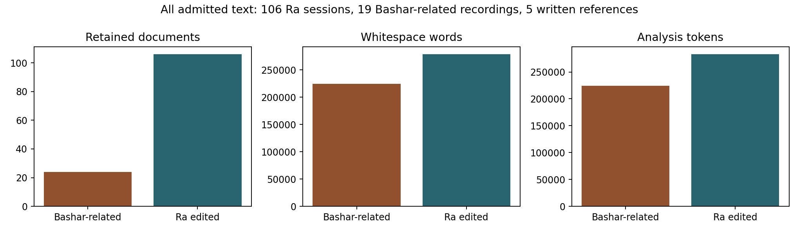{width=95%}

## 4.2. Evidence contracts and exclusions

Every admitted record binds normalized text and original evidence through source IDs, paths, byte lengths and SHA-256 hashes. The normalized text must equal the newline-joined ordered turn texts. Ra extraction receipts are checked against the retained pages; ASR text, segment order and timestamps are checked against completed original receipts and media hashes. Missing or changed evidence for a completed record stops analysis. These checks establish consistency of retained bytes and provenance, not the accuracy of recognition or source claims.

Partial or failed text records are explicit exclusions. Thirty-five handouts are excluded because text-only extraction omits visual relationships or produces corrupted OCR. Three inspected page images demonstrate why this matters: the Parallel Realities extraction retains almost only the title, and the Nine Levels image contains a structured table whose rotated OCR is damaged. Their visual meaning cannot be recovered from a nominally nonempty text file.

Exact repeated source records and exact text aliases are counted once; none were found in this snapshot. A five-token shingle screen checks possible overlap without declaring every shared phrase a duplicate. No pair passed the implemented screening thresholds among 7,750 primary pairs. This does not rule out re-encoding, paraphrase, excerpts or shared original sessions. The original-session identity of many recordings remains unresolved.

## 4.3. Ethical and publication boundary

The public release contains metadata, code, numerical summaries, figures and bounded paraphrases with source locators. Raw copyrighted text, substantial excerpts, audio, source PDFs and the full private question database are not republished with the paper. Public availability does not establish an open training or redistribution license. Source statements concerning health, suffering or abuse are analyzed as claims; their inclusion does not endorse causation, assign blame or supply clinical guidance.

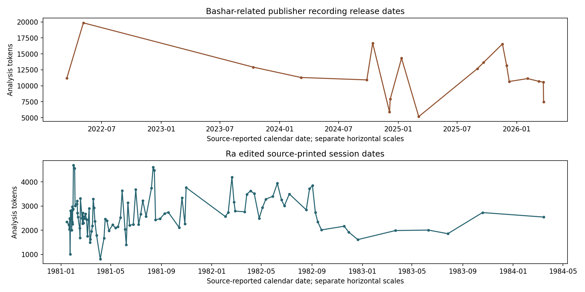{width=95%}

# 5. Methods

## 5.1. Tokenization and dictionary comparison

The analysis normalizes Unicode with NFKC, standardizes curly apostrophes, lowercases text and extracts ASCII-letter words with internal apostrophes. These analysis tokens differ from whitespace words. The primary collection contains 505,748 analysis tokens: 282,966 Ra and 222,782 Bashar-related tokens. English assumptions and the stoplist are explicit; no multilingual validity is asserted.

Ten declared dictionaries operationalize word-form groups: ontology, agency/free will, ethics/polarity, fear, practices, time/probability, contact, healing/body, knowing/uncertainty and relationships. For document $d$ and group $g$, the rate is $r_{dg}=1000m_{dg}/n_d$, where $m_{dg}$ counts exact listed forms and $n_d$ is the document's analysis-token count. An equal-document mean gives each session or recording equal weight; a pooled rate weights by text length. These measures count words in questions, negations, quotations, advertisements and skeptical restatements as well as affirmative claims. They are not semantic classifications.

## 5.2. TF-IDF and sensitivities

The joint vectorizer uses unigrams and bigrams, sublinear term frequency, smoothed inverse document frequency, L2 row normalization, a 12,000-feature cap, `min_df=2` for these sample sizes and `max_df=1.0`. English stop words retain *no*, *not*, *nor* and *never* at the stoplist stage. Preserving a negative word does not make cosine an entailment model; feature selection and pooling can still obscure its role. Similarity is the dot product of normalized document vectors.

Seven variants make selected dependencies visible: raw vocabulary; spoken fillers removed; fillers plus fixed names/source markers removed; centered contiguous 1,500-token windows before filtering; Ra printed responses only with Bashar ASR unchanged; bracketed spans removed; and promotional/commentary source formats excluded. The response-only variant is intentionally asymmetric because Bashar speaker roles remain unidentified. The length control excludes four Ra sessions shorter than 1,500 tokens, leaving 121 documents. The format exclusion leaves 17 interviews and all 106 Ra sessions. Each variant refits its vocabulary/IDF, so differences can reflect both retained text and feature weights.

## 5.3. Topics, clusters and document network

NMF candidates use $k=2$ through $8$, seeds 11, 23 and 47, NNDSVDar initialization, 800 maximum iterations and tolerance $10^{-4}$. Component vectors are matched across seeds using the Hungarian algorithm. Reconstruction error, convergence warnings, iterations and concentration diagnostics are retained. Four components are displayed for readability; they are not a statistically selected optimal topic count. Normalized component weights are decomposition shares, not probabilities that a source holds a belief.

KMeans uses the name/source-marker-filtered vectors, ten initializations, 500 maximum iterations, the same candidate counts and seeds. The displayed solution maximizes the seed-11 cosine silhouette. Corpus labels do not fit or select the solution. Adjusted-Rand agreement assesses seed dependence, not doctrinal validity. A two-dimensional TruncatedSVD projection supplies a visual arrangement; its axes are not metaphysical dimensions.

The graph is the undirected union of each document's three nearest lexical neighbors at cosine at least 0.15. Threshold counts from 0.10 to 0.50 are retained. Circular placement is schematic. Edges connect text documents under this rule, not alleged beings or civilizations. Missing cross-context edges can result from the nearest-neighbor rule and cannot be interpreted as proof of unrelated ideas.

## 5.4. Frozen neural sensitivity and documentary exchanges

The neural baseline is `all-MiniLM-L6-v2` from Sentence Transformers, with separate hashes for the model, tokenizer and configuration, and the complete pinned revision recorded in `snapshot.json`. It is an established English baseline, not a claim of state-of-the-art accuracy for this domain. No weights are trained or edited. ONNX inference uses two intra-operation CPU threads, one inter-operation thread and batches of 16.

Tokenization does not truncate content. Every document is split into nonoverlapping chunks of at most 240 content wordpieces. Attention-mask mean pooling includes the special tokens under the pinned pooling contract; normalized chunk vectors are combined using content-token counts and normalized again. Equal-chunk pooling is a sensitivity using the same inference. Complete processed-wordpiece and chunk counts are reported from the corrected frozen run below, with content truncation explicitly checked. It still loses ordering across chunks and does not interpret every proposition. Caches store float32 vectors, and replay precision is checked separately; replay is not independent model training.

Printed Ra questioner turns are paired with subsequent same-question-ID response turns. Acknowledgments and requests to continue remain documentary prompts. Lost-question notices, opening or orphan responses and bracket-only turns remain explicit. Bashar ASR segments containing a question mark produce punctuation candidates; the following segment is context, not an automatically identified answer. The private SQLite schema separates documents, turns, printed exchanges and ASR candidates.

Neural retrieval requires available question text, a question mark and at least eight analysis tokens. It compares 2,311 Ra prompts with 775 Bashar ASR candidates. All eligible prompts, paired Ra responses and candidates are fully encoded; the question layer records processed wordpieces and checks for truncation. Ra prompt/response cosine is summarized per session and contrasted with one cyclic reassignment of responses within that session. A single shift is a descriptive reference, not a null distribution or significance test.

## 5.5. Bounded qualitative inspection

The initial sample combines midpoint windows, a spread of 12 Ra sessions and dictionary-enriched candidates. Its 50 unique windows contain 10,079 words: 22 Ra exchanges and 28 ASR windows. All were inspected by the model. Nine further Ra exchanges supply conceptual depth and surrounding context. All main text of five official written pages and three complete handout page images were inspected separately. A later purposive audit reads five initial high-cosine retrieval leads, their ASR neighborhoods and three further Ra context exchanges. A corrected-run audit reuses the first four exact pairs and inspects the changed fifth plus Ra80.15–80.17, preserving the original fifth as a historical extra.

Cumulative inspection of the original collections covers 6,775 Ra words across 32 sessions and 6,829 ASR words across all 19 recordings: approximately 2.43% and 3.07% of their normalized words. Complete-session semantic reading is not claimed. One new official public excerpt contributes a separate full inspection of 870 ASR words in 50 segments; the other supplementary excerpts are not thereby read or validated. There is no human annotation, inter-rater agreement or audio-listening validation. Sampling, offsets, hashes, counterexamples and the distinction between original and follow-up coverage are preserved in separate private attestations.

## 5.6. Separate official-publication follow-on

The follow-on preserves publication, edition and model-unit identities separately. One text edition is selected per publication, preferring available platform captions under a declared policy; that preference is not an accuracy ranking. Original WebVTT cues are independently parsed and compared with normalized text, order and timing. Local ASR is checked against completed processing receipts, unchanged segment streams and media hashes. Verified identical encoded-media hashes define one model unit, while each publication remains in the source table and question database. Metadata labels separate excerpts, greetings and promotional/product material. They do not identify every speaker or resolve all shared historical sessions.

Media admission checks packet continuity, with an additional decoded-duration check for local-ASR editions. The retained admitted media have no packet gaps above the declared 0.05-second tolerance. Local-ASR editions must have container/decoded duration disagreement of at most two seconds; platform-caption editions instead have audited linked media and player/acquisition duration checks, without a separately validated decoded-PCM duration. These checks caught an earlier edition of [publication 204089777](https://vimeo.com/204089777) with a 5.994667-second gap and a matching HTTP503 fragment-skip log. That edition and its receipts remain preserved but rejected; a separately acquired strict replacement was recognized and audited before fitting. Passing technical checks is not evidence that the publisher excerpt contains a complete historical session or that recognition is accurate.

The baseline vocabulary, IDF and NMF components remain fitted exclusively to the original 125 documents and are numerically checked against the accepted baseline before projection. A separate NMF exploration fits the 75 ordinary official excerpt units; greetings and promotional/product units do not enter that topic model. Four components are displayed for readability, with candidate and seed diagnostics retained. Centered 400-analysis-token controls use the frozen lexical representation. Neural controls retain the corresponding contiguous source span, including interior punctuation, numbers and case, after declared Unicode and apostrophe normalization. Shorter documents are excluded only from that sensitivity. This controls selected text length, without matching historical period, speakers, editing or source selection.

The original 19-context ASR used the bound tiny English Whisper model with beam size one; new English excerpt ASR uses beam size five. Platform caption settings are unknown. Explicitly translated publications remain multilingual even when a recognizer returns a dominant-language estimate. For two selected caption/local-ASR pairs, token edit distance uses lowercased lexical tokens without punctuation or stopword removal. Because both editions are machine outputs, the measure is edition disagreement, not recognition accuracy or word error rate against verified speech. Cue-interval coverage likewise measures retained timestamp intervals rather than speech recall.

# 6. Results

## 6.1. Word forms describe different textual emphases

Table 2 gives equal-document dictionary rates per 1,000 analysis tokens. Ra has higher rates in the declared ontology, ethics/polarity, healing/body and practices groups. The retained interviews have higher rates in the fear, contact and knowing/uncertainty groups. These are observations about the listed words, not estimates of how much either source genuinely discusses a validated psychological or doctrinal construct. For example, *know* can be conversational filler, *body* can be part of recurring Ra terminology, and *positive* or *negative* can denote more than moral orientation.

| Declared word-form group | Ra mean / 1,000 | Bashar-related mean / 1,000 |
|---|---:|---:|
| Ontology | 9.460 | 4.661 |
| Agency/free will | 6.362 | 5.228 |
| Ethics/polarity | 8.911 | 3.396 |
| Fear | 0.147 | 1.326 |
| Practices | 1.105 | 0.354 |
| Time/probability | 6.857 | 4.660 |
| Contact | 1.683 | 3.319 |
| Healing/body | 12.110 | 3.575 |
| Knowing/uncertainty | 3.763 | 10.146 |
| Relationships | 2.843 | 1.729 |

The pooled-token rates generally preserve these directions but change their magnitudes. For instance, ontology is 9.729 per 1,000 pooled Ra tokens and 4.367 per 1,000 pooled recording tokens, compared with equal-document means of 9.460 and 4.661. Equal-document weighting prevents a long interview from dominating the context mean; it does not make the 19 recordings representative of the larger available media universe.

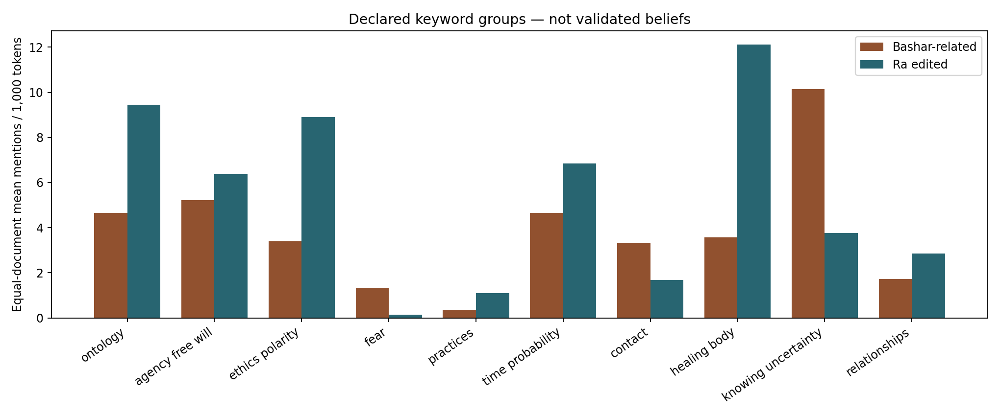{width=95%}

## 6.2. Lexical similarity is sensitive to document length

Within-context mean similarity exceeds across-context similarity in each inspected lexical variant. The raw Bashar-related mean of 0.3862 falls to 0.3508 when fixed spoken fillers and names/source markers are removed. The Ra within mean falls from 0.1564 to 0.1460. Removing names therefore does not eliminate source-context structure. It also does not remove every host, genre, advertisement or editorial cue.

| TF-IDF variant | Docs | Bashar-related within | Ra within | Across contexts |
|---|---:|---:|---:|---:|
| Raw | 125 | 0.3862 | 0.1564 | 0.0913 |
| Spoken fillers removed | 125 | 0.3554 | 0.1502 | 0.0915 |
| Fillers and fixed names removed | 125 | 0.3508 | 0.1460 | 0.0929 |
| Centered 1,500-token windows | 121 | 0.1620 | 0.1070 | 0.0558 |
| Ra responses only; ASR unchanged | 125 | 0.3605 | 0.1385 | 0.0798 |
| Bracketed spans removed | 125 | 0.3509 | 0.1460 | 0.0928 |
| Promotion and commentary excluded | 123 | 0.3628 | 0.1440 | 0.0924 |

The length sensitivity is substantial. The within-recording mean changes from 0.3508 to 0.1620, while the Ra within mean changes from 0.1460 to 0.1070. A whole long interview can share more broad vocabulary with another long interview simply because both cover more subjects. The centered-window comparison changes which content is observed and excludes four short Ra sessions, so it is a sensitivity rather than an identified estimate of a pure length effect. It nevertheless limits any interpretation of the full-document contrast as a direct measure of doctrinal consistency.

The complete primary comparison comprises 171 Bashar-related within-context pairs, 5,565 Ra within-context pairs and 2,014 cross-context pairs. These overlapping pairs are not independent observations: the same document contributes to many of them. We therefore report descriptive means without treating thousands of pairwise similarities as thousands of independent sources. The response-only sensitivity also reduces the across-context mean, but it cannot isolate a speaker effect because unidentified Bashar ASR remains unchanged.

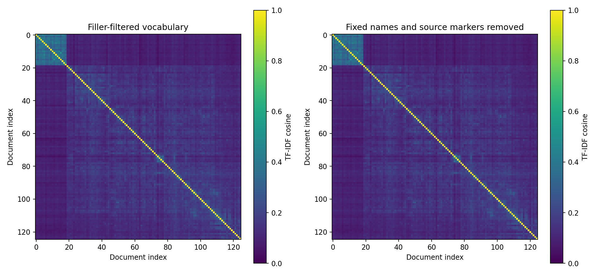{width=85%}

## 6.3. Topic components expose source form as well as subject matter

The four displayed NMF components have distinctive top-word patterns. Component 1 includes density, entities, complex and Confederation terminology. Component 2 combines reality, soul, frequency and passion with remaining spoken forms. Component 3 emphasizes catalyst, mind, veil and archetypical vocabulary. Component 4 emphasizes pyramid and chamber terminology. Those labels summarize visible words; they are not independent annotations of a latent doctrine.

| Display component | Illustrative top terms | Ra mean share | Bashar-related mean share |
|---|---|---:|---:|
| 1 | density; entities; complex; confederation | 0.439 | 0.012 |
| 2 | reality; lot; soul; physical reality; passion | 0.021 | 0.975 |
| 3 | catalyst; mind; veil; archetypical | 0.399 | 0.007 |
| 4 | pyramid; chamber; apex; spiraling | 0.141 | 0.006 |

The concentration of the recordings in component 2 is an important warning. It combines subject matter with conversational language, so it may function partly as a broad source-format component. More components are not automatically better: the six-component candidate reaches the 800-iteration limit for every seed. High agreement for several other candidates occurs under NNDSVDar's closely related starting points and should not be presented as stability under broad resampling, source replacement or human interpretive review.

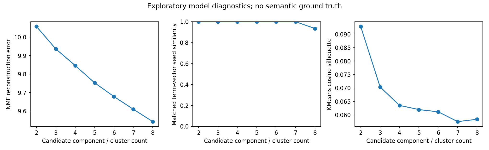{width=95%}

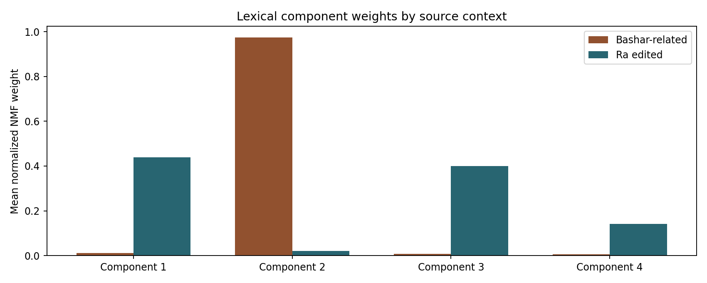{width=90%}

## 6.4. Clusters and network neighborhoods follow source context

The selected KMeans solution has two clusters of sizes 106 and 19, aligning with the two source contexts, and a cosine silhouette of 0.0929. Seed adjusted-Rand agreement is 1.0 for this two-cluster solution, while larger candidate partitions show lower agreement. Reproducible assignment does not make the clusters substantive entities: a low-separation partition can reliably distinguish edited sessions from contemporary ASR while conflating period, editorial practice, host speech and vocabulary.

The two-dimensional SVD display accounts for approximately 5.54% of variance through its reported two components. It is useful for orientation but is a severe projection of a high-dimensional representation. Visual distances in this map should not replace the actual cosine matrix or imply a complete geometry of the documents.

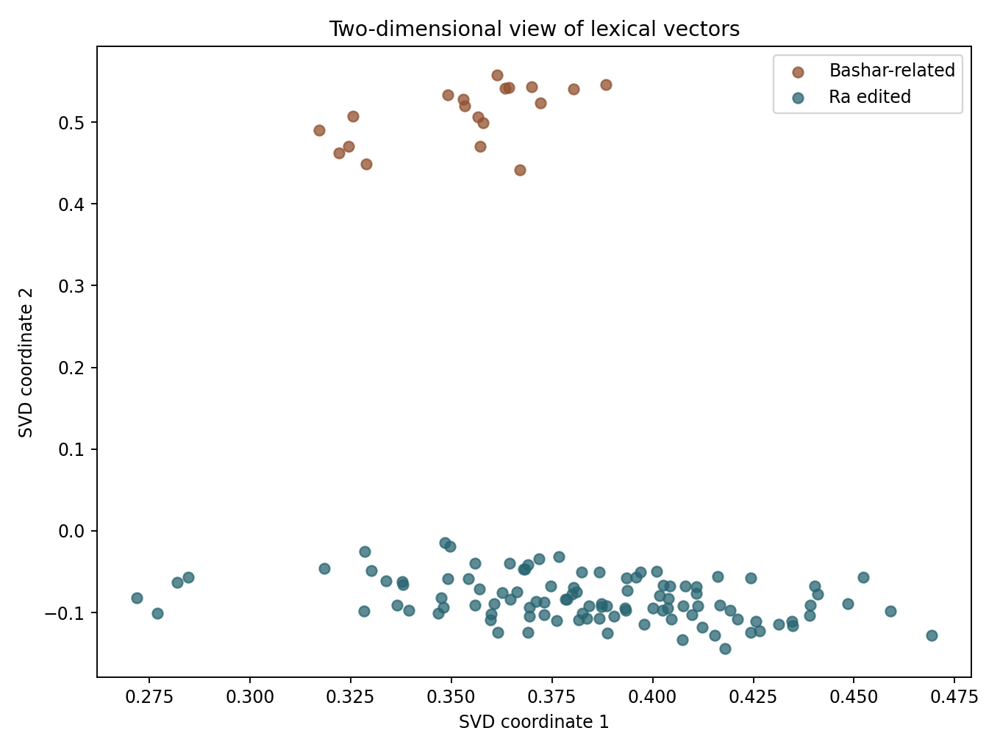{width=90%}

The three-nearest-neighbor graph at threshold 0.15 has 125 nodes and 266 edges, with no cross-context edges. Raising the threshold to 0.25 leaves 105 edges; at 0.50 only one remains. Even at 0.10 there are no cross-context edges under this nearest-neighbor construction. This does not imply zero cross-context similarity: the full matrix has a positive across-context mean. It means that no cross-context document enters the retained top-neighbor relation at those thresholds. The graph is a filtered navigation view, not evidence of disconnected intellectual or physical communities.

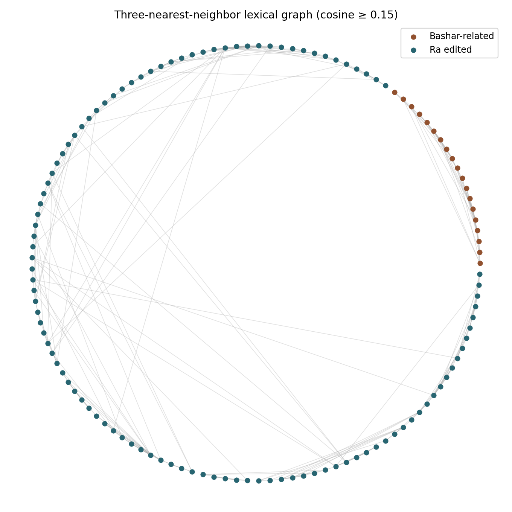{width=95%}

## 6.5. Neural comparison and documentary linkage

<!-- SEMANTIC_RESULTS_START -->
The corrected frozen MiniLM pass processes 610,730 content wordpieces in 2,611 primary-document chunks, with zero content truncation. Equal-chunk versus content-token-weighted pooling changes pairwise cosine by a mean absolute 0.0118, with a maximum change of 0.0806; pair-rank Spearman correlation is 0.9959. High rank agreement addresses this pooling choice, not external semantic validity. The neural cosine scale is not interchangeable with the TF-IDF scale and neither is a probability of belief agreement.

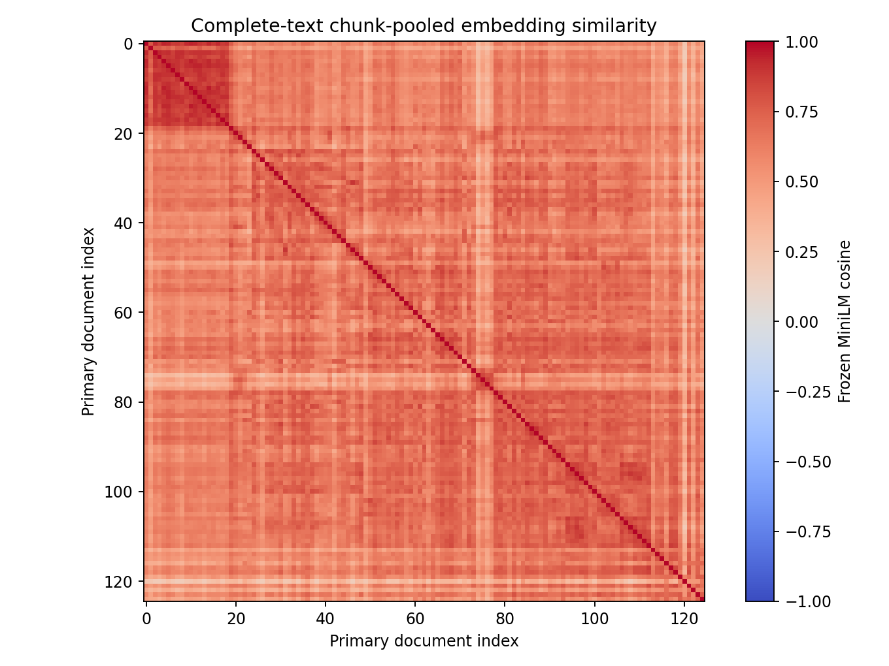{width=85%}

The eligible question layer processes 319,281 content wordpieces across 5,397 prompt/response/candidate items, with zero content truncation. Across 106 Ra sessions, the mean of session-mean matched prompt/response cosines is 0.3350, versus 0.2068 for one within-session cyclic reassignment. Every session difference is positive. This supports a descriptive observation that documentary pairings are more related under this encoder than that particular reassignment. It does not create a null distribution, establish statistical significance, certify answer truth or provide 106 independent experimental replications.

The corrected source-marker filter treats full lexical tokens with apostrophes intact, preserving contractions such as *don't* rather than removing an embedded name marker. All source text remains unchanged. The corrected output is separately hash-pinned; earlier neural scores are superseded. Contextual reading below was rebound to actual corrected retrieval identities, including a newly inspected fifth lead.

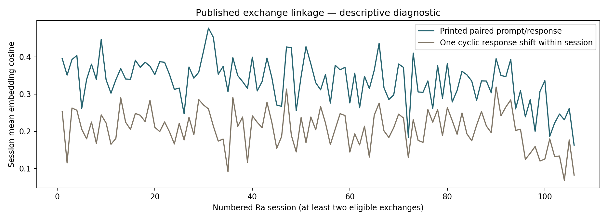{width=95%}
<!-- SEMANTIC_RESULTS_END -->

The question database contains 2,523 printed prompt/response exchanges, including four missing-question placeholders, and 1,303 ASR punctuation candidates. It also preserves 107 Ra response turns without a present questioner and 18 bracket-only turns. These are structural units rather than independently validated substantive questions. For instance, a printed questioner turn can be an acknowledgment, a request to continue or a notice that the original question was lost.

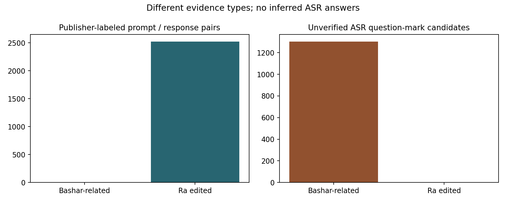{width=90%}

## 6.6. Contextual retrieval audit illustrates the need for context

The five highest-cosine leads in corrected Run04 were checked against actual source identities and context. The first four exactly match previously inspected pairs; the changed fifth received an additional reading, including the surrounding Ra80.15–80.17 exchanges. The original pilot receipts and its former Egyptian fifth remain separate historical evidence. This is not a second independent annotation. The five selected examples demonstrate failure modes and do not estimate retrieval precision across the 775 candidates.

| Corrected case | Source-linked contextual result | Why the proposed match is limited |
|---|---|---|
| Feelings and the body | Ra [61.7](https://www.lawofone.info/s/61#61.7); [Align #561 publisher feed](https://feeds.megaphone.fm/SSM6025167151), ASR 853.34–883.86 s | Broad mind/body family overlap, but examples of sensations differ from a question about somatic versus intellectual work; interview response remains incomplete in the window |
| Spontaneous healing | Ra [66.12](https://www.lawofone.info/s/66#66.12); [Part Two publisher feed](https://rss.pdrl.fm/a88a08/feeds.megaphone.fm/MASL6091580855/), ASR 1553.13–1584.89 s | The ASR candidate combines the end of a prompt with the start of an answer; broad healing language does not establish matched speaker turns or clinical validity |
| What can be done? | Ra [104.5–104.7](https://www.lawofone.info/s/104#104.5); [Episode #248 publisher feed](https://anchor.fm/s/d22ad49c/podcast/rss), ASR 3088.41–3110.17 s | The Ra context concerns a cat's eyesight and treatment burden; the interview concerns social abuse |
| Place and negativity | Ra [106.8](https://www.lawofone.info/s/106#106.8); [Part Two publisher feed](https://rss.pdrl.fm/a88a08/feeds.megaphone.fm/MASL6091580855/), ASR 656.54–696.42 s | A proposed physical location is compared with a question about evil and social disillusionment |
| Spirit and roles | Ra [80.15–80.17](https://www.lawofone.info/s/80#80.15); [Episode #68 publisher feed](https://feeds.megaphone.fm/acidforsquares), ASR 4777.41–4807.89 s | A numbered archetypal concept differs from a comparison between living people's skills and the roles of people described as being in spirit |

ASR times refer to the retained recording. Publisher-feed links are source indexes, not guaranteed timestamp players or verified YouTube editions. Full source titles, IDs and exact intervals are retained in the machine-readable comparison companion.

The corrected five cosine scores are 0.6784, 0.6767, 0.6739, 0.6677 and 0.6652. The historical Egyptian example, no longer fifth, compares Ra1.5 with an incomplete interview question about the Anunnaki; its original source reading remains retained rather than erased.

The two generic/referential failures are especially informative. A sentence asking what can be done has little semantic content without its antecedent. Similarly, *place* can refer to a location or to a conceptual role. A nearest-neighbor system can provide a useful lead while failing precisely at the step required for a comparison of answers. The database's decision not to infer a Bashar answer from the next ASR segment is therefore consequential: a single segment can contain both speakers, and punctuation is insufficient to define dialogue turns.

## 6.7. Official excerpts add a distinct, bounded comparison

The admitted 84 English publications comprise 14 platform auto-caption editions and 70 local-ASR editions. Exact-media grouping leaves 82 units: 14 caption units and 68 ASR units. The following counts describe model units; all 87 discovery-frame publication dispositions remain available separately.

| Supplementary stratum | Model units | Whitespace words | Analysis role |
|---|---:|---:|---|
| Ordinary official excerpts | 75 | 62,590 | Frozen projection and separate excerpt-only topic exploration |
| Promotional/product material | 4 | 2,895 | Separate projection stratum; excluded from excerpt-only topic fit |
| Greetings | 3 | 2,051 | Separate projection stratum; excluded from excerpt-only topic fit |
| Total admitted model units | 82 | 67,536 | Outside the original 125-document primary fit |

{width=95%}

The fixed dictionaries retain their word-form interpretation. Across ordinary excerpts, equal-unit mean rates per thousand tokens are 9.574 for the agency/free-will list, 5.379 for ethics/polarity, 1.520 for fear and 10.324 for knowing/uncertainty. The respective pooled-token rates are 9.521, 5.032, 1.518 and 10.336. Differences between weighting schemes are observable, but both still count forms rather than annotated beliefs. In particular, positive/negative vocabulary and conversational uses of knowing terms require the contextual distinctions demonstrated in the primary reading audit.

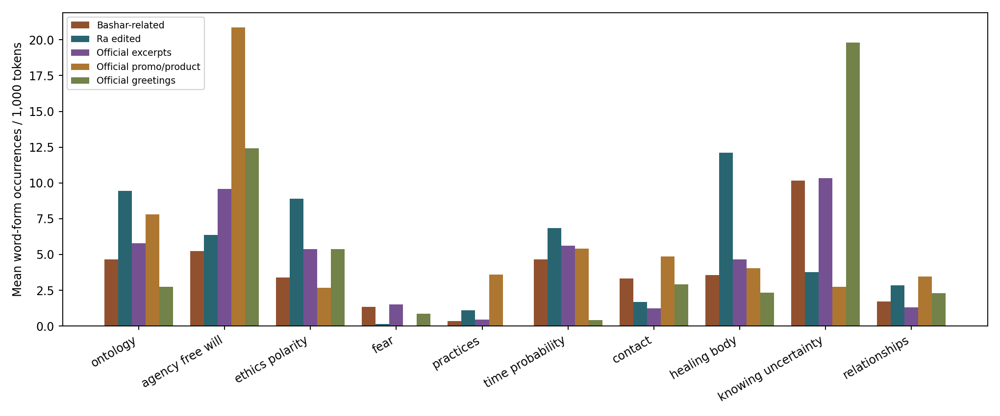{width=95%}

In frozen baseline TF-IDF space, mean excerpt-to-context cosine is 0.1508 across 1,425 pairs, compared with 0.0531 across 7,950 excerpt-to-Ra pairs. With centered 400-token windows these means are 0.0521 and 0.0220. The same excerpt/context pairing is therefore closer on average under both stated length conditions, while the score magnitudes change substantially. These dependent pairs do not provide independent replications or a causal estimate of doctrinal relatedness. No projection has a zero retained-feature vector. One short promotional unit is excluded from the 400-token sensitivity; the 75 ordinary excerpts, 19 contexts and 106 Ra sessions remain eligible for the two comparisons below.

| Representation | Excerpts to mixed contexts | Excerpts to Ra |
|---|---:|---:|
| Frozen TF-IDF, full documents | 0.1508 | 0.0531 |
| Frozen TF-IDF, centered 400-token windows | 0.0521 | 0.0220 |
| Frozen MiniLM, full documents | 0.6147 | 0.4478 |
| Frozen MiniLM, centered 400-token source spans | 0.3377 | 0.2791 |

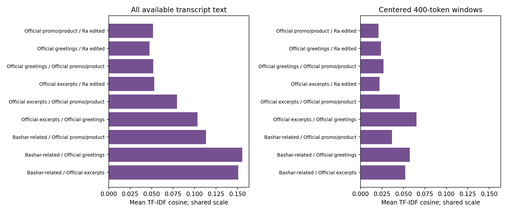{width=95%}

The neural pass covers all 207 combined baseline and official model units: 690,771 content wordpieces in 2,982 chunks, with no truncation. Full-document excerpt-to-context and excerpt-to-Ra means are 0.6147 and 0.4478; centered-source-span means are 0.3377 and 0.2791. Neural and lexical scales must not be read as interchangeable probabilities. Both offer a source-dependent proximity pattern, while neither tests equivalent answers, authenticates a voice or establishes the truth of a claim.

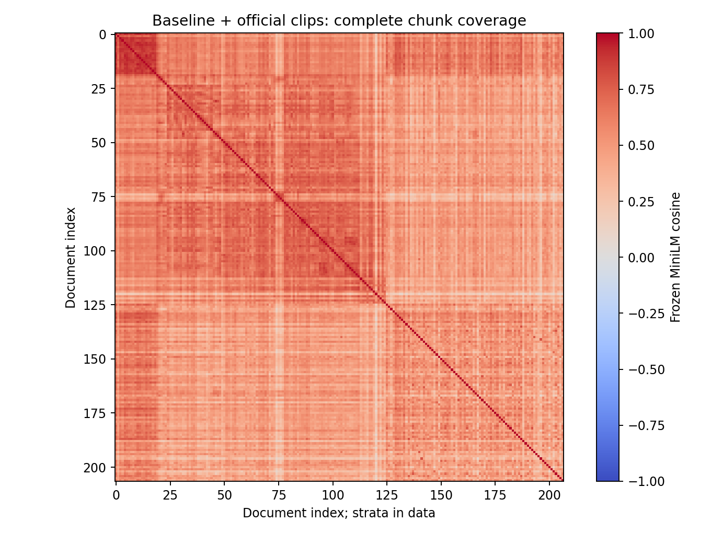{width=95%}

The excerpt-only NMF display separates several top-term families that were compressed into the primary source-format contrast. Its four mean normalized component shares are 0.301 for parallel reality/time/contact terms, 0.362 for positive/negative belief and fear terms, 0.115 for higher/physical mind and visualization terms, and 0.222 for spirit and physical-experience terms. These are summaries of top words, not independently verified thematic labels. The four-component seed-matching diagnostic is 0.8818, so even the narrow structured-initialization check is imperfect. All candidate counts from two through eight converge in this follow-on, but convergence does not select a correct taxonomy.

Internal KMeans partitioning offers especially little basis for categorical claims. The selected three-cluster fit has sizes 38, 26 and 11, a cosine silhouette of 0.0116 and mean seed adjusted-Rand agreement of 0.0665. Other candidate counts also have low separation and weak seed agreement. Thus the source collection supports browsing overlapping word patterns more convincingly than treating its clusters as stable classes of teachings.

The two machine-edition comparisons have token edit distances of four against 606 caption tokens and six against 869 caption tokens, approximately 0.660% and 0.690% respectively. Close agreement between these two outputs does not establish that either correctly captures the audio, and two selected pairs cannot estimate accuracy for the collection. The publication-level database retains 6,736 turns and 479 punctuation-derived question candidates; after exact-media grouping there are 454 candidates. No answers or speaker turns are authenticated by this extraction, and no diarization was performed. The only complete new-excerpt semantic inspection remains the separately documented 870-word time-travel pilot.

# 7. Source-qualified qualitative contrasts

## 7.1. Unity and responsibility do not imply identical teachings

Ra [1.7](https://www.lawofone.info/s/1#1.7), [19.1](https://www.lawofone.info/s/19#19.1) and [4.20](https://www.lawofone.info/s/4#4.20) frame unity as fundamental while describing differentiated experience and development. Bashar's official [Principles](https://www.bashar.org/principles) and [Five Laws](https://www.bashar.org/fivelaws) likewise frame consciousness and physical experience through unity. This supports a broad passage-level parallel, but the developmental vocabularies are not interchangeable. The inspected Nine Levels handout groups several psychological layers within a density; counting nine listed levels does not establish nine densities or a one-to-one mapping to Ra categories.

Both sources also retain a role for the recipient's choices. Ra [17.2](https://www.lawofone.info/s/17#17.2) limits what a teacher can directly confer, describing inspiration or catalyst rather than transferable enlightenment. The official Bashar [Message](https://www.bashar.org/message) presents interaction as reflection that should preserve human responsibility. Ra [2.2](https://www.lawofone.info/s/2#2.2), however, narrates an earlier intervention allegedly distorted through elite capture and accepts responsibility for its effects. That narrative of failure differs from a statement of current noninterference. Neither establishes that individuals control all external events.

## 7.2. Practice and emotional work have different operational forms

Ra [10.14](https://www.lawofone.info/s/10#10.14) proposes attention to love in the moment and recognition of the Creator in other people, oneself and surrounding creation, supported by contemplation, meditation or prayer. Bashar's official [Formula](https://www.bashar.org/formula) links action on enthusiasm to effort, non-insistence on outcomes, a positive stance and belief review. [Seven Steps](https://www.bashar.org/sevensteps) pairs intention and action with allowance. Both offer practical sequences, but the sequences should not be collapsed into a generic positive-thinking label.

The same care is needed with difficult feelings. Ra [18.5](https://www.lawofone.info/s/18#18.5) recommends examining and accepting desire rather than suppressing it, while distinguishing imagination from actions inconsistent with others' free will. The Bashar Formula recommends investigating fear-based beliefs. The inspected Spectrum of Fear handout also recognizes a protective role for fear, which is a direct counterexample to the interpretation that all fear is inherently harmful. These sources discuss overlapping internal experiences, not an identical psychological construct or an evaluated therapeutic intervention.

## 7.3. Time claims change with explanatory frame

Ra [36.4–36.6](https://www.lawofone.info/s/36#36.4) permits an all-at-once frame while rejecting the questioner's simpler interpretation of simultaneous parts of a self. It describes the higher self as future-relative from a human space/time standpoint. The Bashar written references use a one-moment vocabulary and describe past/future experience as related to the present. It would be misleading to label these as either a single equivalent theory or a flat contradiction without retaining their changes of reference frame.

The newly acquired official [Vimeo excerpt](https://vimeo.com/392834325) provides a more specific Bashar-attributed illustration. Its ASR at 96.99–125.15 seconds distinguishes a past-like parallel reality from returning to one's own past. At 164.19–190.82 seconds it describes a reality perceived as future while claiming simultaneous coexistence. Later language presents mutual interaction as forming an overlapping possibility. These passages deepen the comparison of perspectives; they do not demonstrate time travel, quantify probability or verify an event.

The excerpt also illustrates recognition uncertainty. At 132.83–138.75 seconds the ASR includes wording about being able to duplicate a moment amid adjacent statements denying duplication. This inconsistency is retained and flagged, not silently corrected. All 870 output words were read; no listening-based resolution is claimed. The 422.336-second public media and its 28.05–376.38-second recognized span are different coverage measures.

## 7.4. Ethics, contact and health require counterexamples

Ra [18.6](https://www.lawofone.info/s/18#18.6) describes service through attention to others' needs and context. Ra [50.6](https://www.lawofone.info/s/50#50.6) and [87.15](https://www.lawofone.info/s/87#87.15) describe negatively oriented hierarchy and control within the narrative. The Bashar Message emphasizes reciprocity, unconditional love and differing belief systems. These are useful relational parallels, but the word *polarity* itself is not a reliable moral label: Ra [45.10](https://www.lawofone.info/s/45#45.10), selected by the ethics dictionary, concerns ears and magnetic terminology.

Contact claims also use different denominators. Ra [53.15](https://www.lawofone.info/s/53#53.15) refers to a preponderance of contacts within its Confederation/Orion framing. A retained interview's claim about generally positive advanced civilizations concerns a different population and unresolved speakers. Treating them as conflicting measured contact rates would manufacture a comparison neither source supplies. Publisher attribution documents the claim of communication; it does not authenticate the purported interlocutor.

For healing, Ra [4.20](https://www.lawofone.info/s/4#4.20) presents the healer as a catalyst in an individual process. The Bashar Message connects changes in self-understanding with physical experience, but provides no clinical trial or comparable treatment protocol. Ra [105.4](https://www.lawofone.info/s/105#105.4) explicitly describes a particular relapse as physical despite the surrounding metaphysical account. That passage defeats an indiscriminate reading that every illness is purely metaphysical. The documents do not justify attributing illness or harm to a person's beliefs.

## 7.5. Refusal and source framing are part of the answer

Some of the most important observations are absences or corrections in the response. Ra [77.15](https://www.lawofone.info/s/77#77.15) explicitly corrects a questioner's premise; [68.9](https://www.lawofone.info/s/68#68.9) declines to answer on stated free-will grounds; [96.12](https://www.lawofone.info/s/96#96.12) supplies no mechanism for the questioner's proposed hawk-message interpretation. A system that merges a question and response into a bag of words can make an unsupported premise look like a supplied explanation.

The interview contexts have a complementary problem. Actual inspected windows contain commercial or charitable sponsorship, skeptical retelling, personal anecdote and a statement about teaching the Formula in one's own voice. Their vocabulary may resemble the teaching while their speech act and attribution differ. A relationship-themed charity advertisement is not a doctrinal answer. These counterexamples motivate retaining source-format and turn uncertainty in retrieval interfaces instead of displaying one undifferentiated transcript-derived knowledge base.

# 8. Discussion

## 8.1. What the combined evidence supports

The quantitative and qualitative layers answer different questions. The lexical results show that the retained source contexts have different word distributions and nearest-neighbor structure. The length sensitivity shows that a substantial part of the observed contrast depends on the amount and selection of text. The reading layer identifies passage-level parallels and contrasts that those global measures cannot establish on their own. In particular, unity and recipient responsibility recur in the inspected official references, while practical sequences, time frames and qualifications remain distinct.

These observations are compatible with multiple explanations. Different teachings may contribute to the vocabulary patterns, but so may editing, period, host prompts, advertising, recording length and recognition errors. The current design does not separate these explanations. With only two nominal source contexts, adding many turns or overlapping pairs cannot create an independent population of communicators. A source-aligned cluster is therefore a finding about this collection, not a discovery that one doctrine is mathematically distinct from another in all media.

The retrieval audit offers a concrete design lesson. A useful interface should show the candidate question together with its preceding referent, documentary response or uncertain following context, source format and timestamp. It should support a classification such as *broad question family*, *different referent*, *response missing* or *attribution unresolved*. A single number and two shortened sentences conceal the information most likely to overturn the proposed match. The accompanying dashboard and private database retain those distinctions rather than manufacturing a universal Q/A table.

## 8.2. What the new official material changes

The new official excerpts improve access to publisher-attributed speech, but they do not automatically solve comparability. Short promotional selections can favor memorable or marketable claims; auto-caption tracks and local ASR have different recognition processes; several public publications can derive from one longer session. Their original session families and selection mechanisms therefore remain important. The executed supplementary analysis characterizes these excerpts and projects them into the existing representation while preserving the primary result. Its length controls retain an average proximity difference, but its weak internal clusters discourage a definitive topic taxonomy. The explicit publication/model-unit denominator and recognition settings make this a more informative source comparison without making it a matched experiment.

New material can also modify an interpretation without invalidating the audit trail. The official time-travel excerpt adds a distinction between a past-like parallel reality and one's own past. That distinction qualifies a simplified reading of the short written principles. It does not retrospectively change what the original model saw, and it does not justify silently replacing an inconvenient result. Versioned inputs, separate attestations and living-paper sections make such updates visible.

# 9. Limitations

**Sampling and source dependence.** The Ra frame is complete for one selected published edition; the retained Bashar-related recordings are a convenience collection of publisher contexts. Neither defines all available videos, tapes, speakers or historical sessions. Publication dates are not uniformly event dates, and original-session identity is unresolved for some material. Exact-hash and five-token screens do not detect all latent duplication.

**Confounded comparison.** Corpus label coincides with period, editing, genre, dialogue structure and recognition process. The lexical controls address selected observable features but cannot identify a causal doctrinal effect. Joint vocabulary and IDF also reflect the unequal 106-versus-19 document counts. Pair counts are not independent sample sizes, and the two source contexts cannot support general population claims about channeling.

**Recognition and editorial uncertainty.** ASR has not received a stratified listening audit, speaker diarization or systematic advertisement segmentation. A transcript can contain incorrect negation, fabricated phrases or mixed speaker turns. Ra editorial roles and reconstruction improve documentary structure without authenticating a voice or restoring missing original audio. The handout exclusions show that a text extraction is not equivalent to complete visual understanding.

**Model and selection limits.** Exact dictionary forms are not validated semantic labels. TF-IDF ignores much compositional meaning; embeddings and chunk pooling can overlook negation, temporal scope or antecedents. NMF display count is chosen for readability, its seed checks use closely related initializations, and one candidate does not converge. KMeans silhouette is low, the SVD view retains little variance, and network edges depend on a declared filtering rule. The corrected neural masking implementation is versioned separately from the historical retrieval audit. The official excerpt-only clustering is also weak and seed-sensitive; four displayed NMF word families are exploratory components, not an externally validated taxonomy.

**Limited interpretation coverage.** Only small portions of the original corpora received semantic reading, with deliberate enrichment and follow-up selection. This increases the chance of finding a useful example but cannot estimate population prevalence, typicality or retrieval precision. All readings in this increment are model-assisted; no human reliability study or complete expert review has occurred. Apparent differences may also depend on passages not yet inspected.

**External validity and rights.** This study measures text and source structure. It does not establish historical accuracy, therapeutic effectiveness, paranormal phenomena or the identity of a purported interlocutor. Source availability does not establish permission to redistribute full texts or train a model. No clinical, physical or predictive experiment is reported.

# 10. Planned validation and living-paper agenda

The following distinguishes completed first steps from proposed validation studies. Any future confirmatory protocol should be fixed before interpreting outcomes.

| Planned work | Concrete design and comparison | Status |
|---|---|---|
| Human source and ASR audit | Sample by publisher, format, duration and recognition source; compare bounded audio spans with transcript; annotate speaker changes, advertisements, negation, names and numbers | **TBD**; no error rate currently available |
| Human question-family evaluation | Independently label a stratified sample of retrieval leads and non-leads; distinguish common family, equivalent proposition, different referent and insufficient context | **TBD**; no current precision or agreement estimate |
| Stronger format matching | Extend the completed official-publication projections and 400-token controls to independently checked speaker roles and matched Ra response passages | Projection/length study complete; role-matched validation **TBD** |
| Session-family resolution | Identify excerpt/repost/edition families through provenance and bounded content review before any train/test split | **TBD**; exact-media families alone are insufficient |
| Broader topic sensitivity | Resample at source/session-family level, vary vocabulary and initialization families, and compare component interpretation on held-out passages | **TBD**; current seed matching is narrower |
| Role-aware retrieval | Evaluate complete question/context blocks and explicitly identified answers against segment-level retrieval; retain refusals and unknown speakers | **TBD**; current database supports this distinction |
| Claim-level comparison | Record each proposition's scope, modality, negation, reference frame and counterexamples; test whether claimed parallels survive contextual review | Initial examples available; systematic evaluation **TBD** |
| Grounded question answering | Retrieve source passages with exact citations and uncertainty/attribution labels; evaluate answer faithfulness and abstention on unresolved cases | **TBD**; no fine-tuning or new model weights claimed |

A future forecasting study would require dated claims, a prespecified outcome definition, a complete claim-selection rule, comparison baselines and blinded outcome coding. A future health study would require a separate clinically appropriate design and evidence. Neither can be inferred from lexical similarity, a topic component or an evocative anecdote. These possibilities are mentioned to define the boundary of the present work, not to imply that its data already support such conclusions.

# 11. Reproducibility and availability

The repository retains acquisition adapters, analysis code, tests, the living manuscript, a bibliography and figures. Each accepted analysis run binds its script, source manifests and output artifacts. The primary analysis unit is the complete retained document; tokens, chunks, turns and overlapping pairs are not promoted to independent observations. The compiled paper and dashboard publish only the approved metadata/results layer. The full private SQLite Q/A database, source media, substantial transcript excerpts and model caches remain outside the public release.

The environment versions recorded for the analysis include NumPy 2.3.5, SciPy 1.17.0, scikit-learn 1.8.0, Matplotlib 3.10.8 and ONNX Runtime 1.23.2. The frozen MiniLM weights are reused without training. Automated invariant tests and model-agent review address code and provenance consistency; they are not human peer review or evidence of ASR accuracy. Paper generation uses Pandoc and pdfLaTeX, with source and build scripts included. `snapshot.json` records the exact baseline and separate final official-study analysis/figure hashes used by the paper. The older 15-publication pilot stays pinned as historical evidence rather than being relabeled as final-frame coverage.

For the original source-reading evidence, the initial selection and its completed-reading attestation are separate artifacts. A later follow-up records new inspected intervals without overwriting the initial selection. The public comparison JSON links paraphrases to session/question IDs or ASR seconds. The methodological reference note records actual page/abstract access depth. These contracts allow later readers to distinguish acquisition, computation, interpretation and validation as the project grows.

# 12. Conclusion

The retained Ra and Bashar-related materials can be compared reproducibly, but their production contexts must remain part of the analysis. Their lexical distributions and fitted components differ, and several source-linked passages share unity-oriented or agency-related themes. Those observations do not establish equivalent teachings or a common origin. The larger official-publication follow-on retains source-dependent proximity under length controls but produces weak internal clusters. Document-length sensitivity, editorial structure, mixed speakers and contextual retrieval failures materially limit stronger conclusions. A useful research resource preserves those limits while making the underlying examples, exclusions and future validation tasks easier to inspect.

# References
