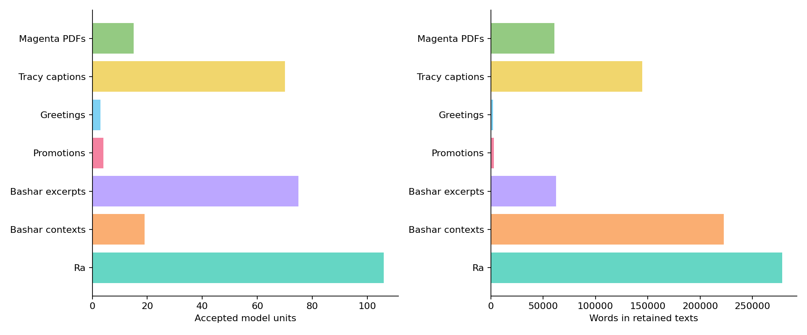
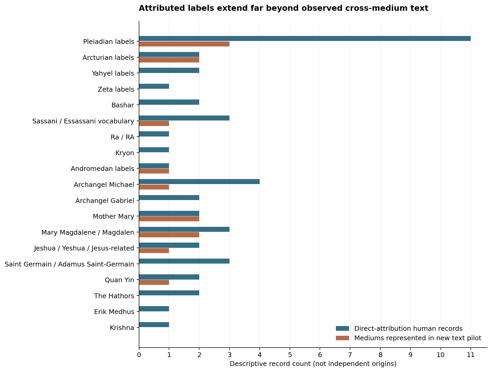
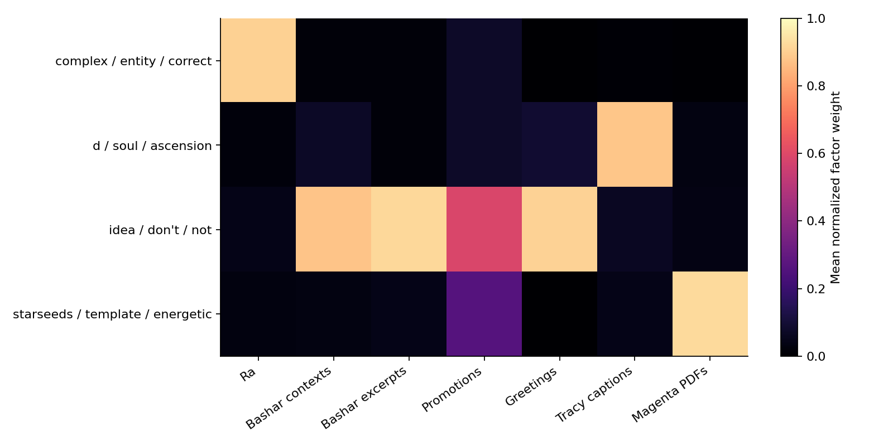
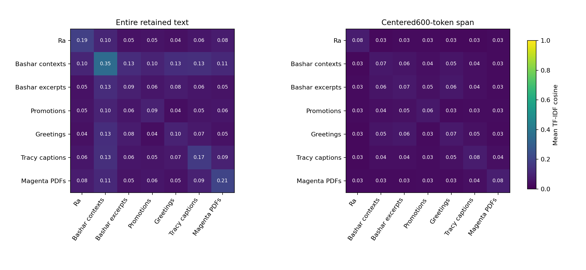
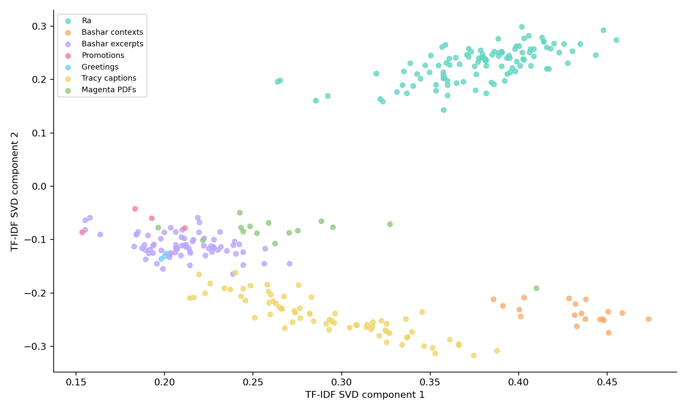
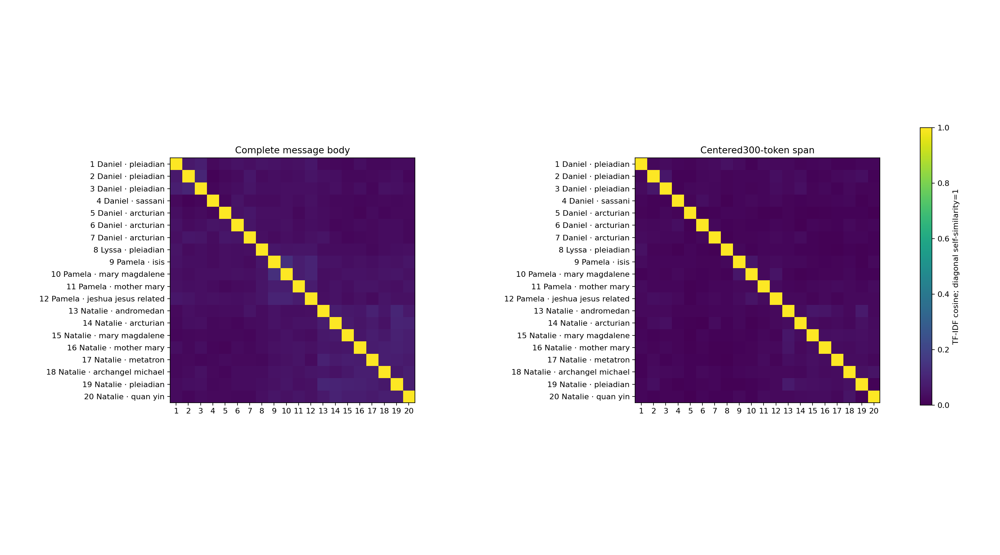
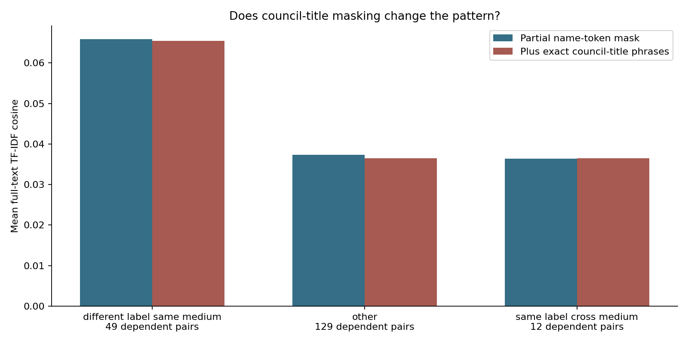

# Introduction

A channel account is not a medium, a medium can be associated with several named sources, and a shared name can refer to different claims in different publishing contexts. These distinctions become consequential when an online archive combines a historical dialogue collection, recent interviews, promotional excerpts, publisher transcripts and messages presented as coming from extraterrestrial collectives or sacred figures. An attractive network can obscure those differences if every account becomes a person, every mention becomes a speaker attribution, or every shared word becomes evidence of agreement.

This study expands an existing Bashar–Ra source project while preserving its earlier analyses and paper. The expansion follows user-selected channel accounts and a bounded set of publisher-linked leads. It asks how a larger comparison can remain auditable when available evidence ranges from a readable message body to a directory listing, a channel biography or an inaccessible archive page. The practical objective is a research dashboard and living paper in which a reader can move from a group comparison to a person, an attributed source, an actual document and its collection status.

The unit of analysis matters. “Pleiadian” can label a civilization, a named council, an unnamed collective or a particular attributed speaker. “Kryon” is a named entity label, not a civilization. A publisher's “Hathors” collective should not automatically become the Egyptian goddess Hathor. A claimed modern message labeled “Ra” should not be silently combined with the historical L/L Research material or with an Egyptian religious tradition. Similarly, a host introducing a guest, a researcher maintaining an archive and a reposter publishing excerpts are not additional mediums by virtue of appearing on a channel.

Our contribution is an integrated comparison protocol and an executed, bounded example. The protocol preserves typed attribution and unresolved identity, separates the source register from observed text, distinguishes lexical retrieval from equivalent questions, and binds published figures to immutable inputs. The empirical work combines a new joint fit of accepted texts with a small, separately analyzed message pilot. It adds evidence about this corpus and its measurement problems; it does not introduce a new topic-model algorithm or claim to be the first computational study of religion, channeling or online video.

Three questions guide the paper:

1. **Attribution and coverage:** Which repeated labels have multiple directly attributed human records, and which have enough observed cross-medium text to support comparison?
2. **Lexical organization:** How do source-context similarity, exploratory topics and clusters change with length, genre and name-masking controls?
3. **Interpretive validity:** Do lexical matches yield equivalent questions or comparable practical recommendations when their source contexts are read?

These are exploratory questions, not preregistered hypotheses. The manuscript is an AI-assisted living research draft. Human authorship, independent human annotation and external peer review remain TBD.

# Methodological context

A source-rich archive can still be a poor basis for inference if curation, speaker roles, language, editing and recording conditions are unspecified. Data statements provide a useful framework for reporting such decisions [@bender2018]. We apply that principle by distinguishing edited historical dialogue, mixed-speaker ASR, publisher-hosted captions, PDF excerpts and publisher-attributed message bodies. The same framework explains why an account inventory cannot serve as a denominator for analyzed speech.

Topic models also require interpretation beyond their most prominent words. Doogan and Buntine examine limits of aggregate interpretability measures and motivate reading representative documents alongside topic displays [@doogan2021]. Our factor labels are therefore descriptive term lists, not discovered doctrines. Their human expert evaluation was not reproduced here. Schroeder and Wood-Doughty distinguish reliability questions from simple similarity or stability diagnostics [@schroeder2025]. Their experiments concern LDA; they do not validate our NMF settings or provide a general threshold for meaningful cosine similarity. We report our seed and perturbation checks by their actual scope.

Leakage and source dependence are relevant even when the immediate task is unsupervised. Multiple excerpts from one recording, editions of one session and text repeated by different accounts can exaggerate apparent diversity. The abstract-level evidence inspected for Kapoor and Narayanan motivates explicit provenance and caution about future predictive claims [@kapoor2023]. It does not establish that the present corpus is free of shared-source dependence. Any later classifier or language-model evaluation should keep related recordings, excerpts and editions together when separating training and evaluation data.

ASR introduces a different uncertainty. The abstract inspected for Koenecke and colleagues documents hallucinated speech in its evaluated conditions [@koenecke2024]. We use it to motivate preservation of audio provenance and a future listening audit, not to import a hallucination rate into this collection. A complete decoder pass proves that a retained file can be processed; it does not establish recognition accuracy, speaker identity or correspondence between a recording and a publisher transcript.

A substantive review of channeling and religious-studies scholarship, together with YouTube and platform-study literature, remains **TBD**. This methods-focused selection does not establish scholarly novelty.

The five methodological references were inspected in an earlier project increment at the access depths documented in Appendix A. This companion paper reuses that record. It does not claim a fresh, comprehensive literature review, a new review of entire papers whose abstracts alone were available, or verified compliance with a current conference submission template.

# Source design and collection

## Three evidence layers

The register, the text corpus and the interpretation are separate objects. The **register** stores attributed relationships: a person reportedly channels a named entity or collective, works with a civilization label, reports contact, appears in a series, or is merely associated with an archive category. The **observed text** comprises exact retained documents admitted under a stated extraction rule. The **interpretation** is a bounded reading or exploratory calculation grounded in those documents. No layer automatically supplies the missing evidence required by another.

Source records include a canonical URL, actual access depth, retrieval status, date, content or artifact hash and a supporting location or paraphrase. Historical retained metadata remains historical. Failed requests and rejected candidates remain in the ledger without becoming supporting observations. A formerly relevant domain that now returns unrelated material is not evidence for its historical claimant. The graph merges shared person IDs only when immutable identity fields agree; uncertain aliases and distinct source-specific labels remain separate.

The typed graph contains **150 source records, 41 person records, 52 claimed-name records and 69 relations**. These include weaker relationships and non-medium roles. They are not counts of authenticated people, complete channels, independent origins or true paranormal communications. Its **19 comparison groups** distinguish civilization labels, shared names and related-name/aspect comparisons. This last category matters, for example, when a publisher expressly distinguishes a particular Magdalen aspect rather than claiming an interchangeable source.

{width=100%}

## Discovery, queries and access

Discovery began from the screened subscription accounts and inherited repository leads, followed by ordinary public publisher pages and first-page search-index results. Queries combined *channeling* with names and civilization labels, including Sassani, Ryokah, Royukh, Pleiadians, Arcturians, Yahyel, Zeta, Andromedan, Ra, Kryon and Nine; the complementary traditions work examined angelic, religious and named-person claims. The registers preserve executed query strings and source receipts. Ranked results were discovery aids rather than random samples, body-level evidence or complete upload counts. Search-engine summaries were not accepted as source assertions. Unrelated results and unsuccessful requests were recorded rather than converted into evidence.

The user spelling *Royukh* remains unresolved. RYOKAH and RYO appear in Tyler Ellison's publisher branding, while other variants appear in testimonials or indexed titles. A search engine returning a plausible neighboring spelling is insufficient to assert an identity or renaming history. Kristin Davies' inspected biography supports generic mediumship claims but not an Erik attribution; the unsupported link was excluded. Erik series metadata distinguishes the host from listed or directly attributed mediums.

YouTube access remained restricted in the managed runtime. Publisher websites, permitted public text, feeds and page-linked recordings provided separate acquisition routes. No alternate egress or proxy-site route was used to turn an inaccessible platform response into an asserted crawl. The current duration policy admits non-Bashar recordings without a five-minute threshold, while **Bashar material retains a 300-second minimum**. The earlier count cap is not retained. These rules govern new collection; they do not retroactively make historical cohorts complete.

A corrected parse of **23 saved Magenta publisher archive pages** yielded **1,114 unique linked YouTube IDs**, including an explicitly linked Short omitted by the earlier parser. This is publisher-link metadata, not 1,114 downloaded videos, a verified uploader-owned inventory or the total upload count. The separate new audio frame comprises **224 RSS enclosures and five OmNa page-linked recordings**. Its collection and ASR progress are operational states with their own timestamps and receipts. We omit changing completion counts from this fixed paper snapshot. The dashboard exposes the current hash-bound projection separately.

## The accepted joint corpus

The joint fit admits accepted, normalized English text from three previous study outputs, with exact-media or exact-text aliases already collapsed under their recorded rules. It retains the earlier analyses rather than overwriting them. Each admitted artifact is rechecked for identity, bytes, hash and word count. Earlier full acquisition and ASR validations are reused as prior evidence; the joint fit does not claim that all media or speech recognition was performed again.

| Source context | Units | Words |
| --- | --- | --- |
| Ra edited sessions | 106 | 278,601 |
| Bashar-related interviews / commentary | 19 | 222,699 |
| Official Bashar excerpts | 75 | 62,590 |
| Official promotion / product | 4 | 2,895 |
| Official greetings | 3 | 2,051 |
| Tracy publisher captions | 70 | 144,568 |
| Magenta transcript PDFs | 15 | 60,706 |
| Total | 292 | 774,110 |

Table: Accepted joint source-context units. Word counts are whitespace-delimited after the stated normalization. Context labels do not identify every speaker in a document.

The 292 units are not 292 independently sampled recordings or verified channeling sessions. Ra pages are edited published sessions. The Bashar-related interviews and commentary contain mixed voices; official-channel origin does not identify every utterance in an excerpt, greeting or promotional item. The Tracy captions and Magenta PDFs also retain their own publisher and extraction limitations. Reference works, incomplete handouts, excluded language editions and alias dispositions remain recorded separately.

{width=92%}

## The new attributed-message pilot

The second fit contains **20 newly collected message bodies, 20,829 words, four mediums and 11 comparison labels**. It is a purposive feasibility sample with explicit page-local attribution and extraction boundaries. It is neither a complete archive nor a random sample. The four contexts and their sizes are shown below.

| Publisher-attributed medium | Documents | Words | Distinct comparison labels |
| --- | --- | --- | --- |
| Daniel Scranton | 7 | 3,907 | 3 |
| Lyssa Royal Holt | 1 | 2,671 | 1 |
| Pamela Rose Kribbe | 4 | 7,324 | 4 |
| Natalie Glasson | 8 | 6,927 | 8 |

Table: New message pilot. The label sets overlap across mediums; their row counts therefore do not sum to the 11 unique comparison labels.

Daniel Scranton's public WordPress responses illustrate the need for body-level attribution. A keyword search for *Pleiadian* returned Arcturian messages containing incidental Pleiadian mentions or promotional links. Only the actual message title and opening/closing attribution determined the admitted label. Seven Daniel bodies were bounded by the message paragraphs before promotional tails. The three Pleiadian High Council messages were published in April 2016; the Arcturian and Ashanti messages were published in 2026.

Lyssa Royal Holt's *Preparedness* PDF is a five-page excerpt from a session dated 23 July 1993. Its header identifies Sasha through Lyssa Royal, and its body explicitly describes Sasha's own Pleiadian community. The complete normalized dialogue contains 2,742 words. Five printed `Question:` paragraphs were retained separately, while a 2,671-word response derivative entered the pilot. Continuation attribution follows the printed layout; it is not a verified voice identification. The excerpt is not represented as the complete underlying recording or session.

Natalie Glasson and Pamela Rose Kribbe contribute messages with page-local named attribution, including the two Marian name comparisons. Publisher comments, navigation and unrelated material were excluded. These modern messages are contemporary source claims, not representative samples of Christianity, Buddhism, Hinduism, ancient Egyptian religion or any other tradition whose names appear in the wider register. No audio alignment of the 20 bodies was verified in this pilot.

# Analysis

## Lexical representations and comparisons

Unicode compatibility normalization and tokenization preserve apostrophes and negation. Complete source-name tokens are masked; the procedure does not remove `don` from `don't` or `ll` from `we'll`. A declared filler list and English stop list are used while retaining no, not, nor and never. This is a specified token mask, not a guarantee that every source-identifying phrase has disappeared.

For the joint study, TF-IDF uses unigrams and bigrams, sublinear term frequency, smoothed inverse document frequency, L2 normalization, a minimum document frequency of two and at most 12,000 features. Before normalization, a term with positive count $c_{td}$ receives weight

$$w_{td}=(1+\log c_{td})\left[\log\frac{1+N}{1+\operatorname{df}(t)}+1\right].$$

Cosine is the dot product of the normalized vectors. We average all eligible unordered pairs within a context, excluding self-pairs, and all cross-context pairs between contexts. These pair averages are descriptive. A document participates in many pairs, so pair counts are not independent sample sizes.

The joint sensitivity selects a centered 600-token span before masking and transforms it with the fixed whole-document vocabulary and IDF. Shorter documents are excluded rather than padded. A genre restriction excludes official promotions and greetings plus baseline promotional/skeptical formats. A separate removal of the single longest document refits vocabulary and IDF. These changes probe sensitivity to some format and length differences; they do not isolate a causal length effect or eliminate all contextual confounding.

The pilot uses the same broad representation family with minimum document frequency one and a fixed-IDF centered **300-token** comparison. Twenty exact text hashes are distinct. A later sensitivity removes explicit full council-title phrases before the existing token mask and refits vocabulary/IDF. The original scores and exploratory models remain available rather than being replaced after inspecting the sensitivity.

## Topics, partitions and lexical networks

NMF and KMeans explore joint values of $k=2$ through $8$ with seeds 11, 23 and 47. Four NMF components are displayed for readability, without declaring four optimal. Component names are prominent terms; normalized component weights are factors, not probabilities of a doctrine or validated topic membership.

For the joint KMeans display, the selected $k$ maximizes the seed-11 cosine silhouette across the tested values. Source-context labels do not enter fitting or this selection. The adjusted Rand comparison with source contexts is then reported as a descriptive diagnostic. SVD provides a two-dimensional display, not a spatial map of belief or a validated measurement of conceptual distance. The pilot declares three components/clusters for its small exploratory display rather than optimizing an inferential criterion.

Two networks remain distinct. The typed claim network encodes documented relationships and comparison groups. A lexical network exposes the top 25 cross-context TF-IDF pairs in the joint corpus. Its edges are retrieval relationships, not social ties, corroboration, causal influence or authenticated agreement between claimed entities. Reporting them together without their edge types would obscure their different meanings.

## Question retrieval and source reading

The private Q/A database separates printed documentary pairs from unknown-speaker punctuation candidates. It contains 2,523 Ra pairs, including four missing-question placeholders. A printed response is a documentary pairing, not voice authentication. For other contexts, punctuation is segmented within existing cue/page boundaries. An adjacent fragment is not automatically an answer, and unknown answers remain unknown.

Initial inspection exposed generic-fragment false matches. The corrected exploratory retrieval requires 6–80 masked tokens and at least four distinct non-stop content unigrams, uses question-only TF-IDF with minimum document frequency one, and deduplicates exact question text when fitting vocabulary. A candidate needs cosine at least 0.35, a best-versus-runner-up margin at least 0.03 and at least three shared content unigrams to become a review lead. Thresholds were adapted after inspection; no precision estimate or held-out validation is claimed.

For the new pilot, the methods role read nine complete bounded bodies totaling 11,274 primary words, plus the 71 Lyssa question words excluded from its model text. Four comparative readings preserve shared themes, different recommendations and counterexamples. The question headings used to organize these readings were composed by the analyst. They are not evidence that multiple mediums answered the same observed audience question.

# Results

## Repeated labels are more common than comparable text

Thirteen of the 19 graph groups contain at least two directly attributed human records. Only four have cross-medium message bodies in the new pilot: Pleiadian labels, Arcturian labels, Mother Mary and Mary Magdalene. The Pleiadian group has 11 direct-attribution human records but 10 declared practices because Pia Orleane and Cullen Baird Smith form a joint practice. Neither the person count nor the practice count establishes independent origin.

| Comparison group | Direct-attribution people | Direct records | Pilot mediums |
| --- | --- | --- | --- |
| Pleiadian labels | Arkayla, Barbara Marciniak, Cullen Baird Smith, Daniel Scranton, Lyssa Royal Holt, Nora Herold, Pia Orleane, Rob Gauthier, Sam the Illusionist, Wendy Kennedy, Natalie Glasson | 11 | 3 |
| Arcturian labels | Daniel Scranton, Natalie Glasson | 2 | 2 |
| Yahyel labels | Shaun Swanson, Wieteke Koolhof | 2 | 0 |
| Bashar | Andrew, Darryl Anka | 2 | 0 |
| Sassani / Essassani vocabulary | Andrew, Daniel Scranton, Tyler Ellison | 3 | 1 |
| Archangel Michael | Daniel Scranton, Diana Muenz Chen, Natalie Glasson, Ronna Herman Vezane | 4 | 1 |
| Mother Mary | Natalie Glasson, Pamela Rose Kribbe | 2 | 2 |
| Mary Magdalene / Magdalen | Natalie Glasson, Pamela Rose Kribbe, Tom Kenyon | 3 | 2 |

Table: Selected repeated-label groups. “Direct” means an explicitly supported attribution relationship, not paranormal verification or a reviewed recording. Names may denote different councils, individuals or aspects; their source-specific records remain separate.

The repeated Bashar-name case requires careful wording.[^elan] Elan Interactions states that Bashar trained Andrew for two years and that Darryl Anka confirmed this. The inspected passage does not establish a direct human Andrew–Darryl teacher relationship. It also makes an assumption of independent source origin inappropriate. Andrew is identified by the first name used by the publisher; an unverified expanded identity is not substituted.

Kryon and Ra each retain a directly attributed historical or established publisher record alongside weaker modern archive-category evidence in the wider register. A category association cannot be promoted to an inspected session. The Erik group similarly distinguishes direct attribution from people listed in series metadata. The current graph therefore supports a research queue rather than a pretense that all named-label comparisons already have equivalent evidence.

{width=96%}

## Joint lexical structure follows source context

The selected joint KMeans partition has $k=3$, cosine silhouette **0.08368** and source-context adjusted Rand index **0.82384**. The close correspondence with source context is evidence of substantial source organization in these vectors. It is not validation of three underlying doctrines, nor a test of whether any claimed entity exists. The relatively low silhouette and the dependence on the tested representation further discourage a strong categorical interpretation.

The four displayed NMF factors also align strongly with publishing contexts. One emphasizes *complex, entity, correct, density* and receives a mean normalized weight of 0.905 in Ra sessions. Another emphasizes *soul, ascension, frequencies* and receives 0.881 in Tracy captions. The *idea, don't, not, reality* factor receives 0.922 in official Bashar excerpts. A *starseeds, template, energetic* factor receives 0.926 in Magenta PDFs. These are group-average factor weights, not probabilities or externally validated labels. Surviving source-specific expressions, editorial form and the selection frame can contribute to this separation.

{width=100%}

Whole-document and centered-window similarities differ substantially. The window analysis includes **278 of the 292 units**; 14 shorter units are excluded. Selected comparisons make the scale of the change explicit.

| Context pair | Full text | 600-token spans | Pair counts: full / window |
| --- | --- | --- | --- |
| Ra / Bashar-related context | 0.10278 | 0.02589 | 2,014 / 2,014 |
| Bashar-related / official excerpt | 0.12843 | 0.05728 | 1,425 / 1,197 |
| Ra / Magenta | 0.07716 | 0.03066 | 1,590 / 1,590 |
| Tracy / Magenta | 0.09267 | 0.04210 | 1,050 / 1,050 |

Table: Mean joint TF-IDF cosine for selected context pairs. The window representation keeps the whole-text vocabulary/IDF but changes text extent and, for some pairs, eligible units. Pair values are dependent.

{width=100%}

The longest document is a Magenta PDF of **23,969 words**. It appears in **19 of the 25** displayed cross-context lexical-network edges. Removing that document and refitting reduces the Bashar-related interview/Magenta mean from 0.11446 to 0.10479. This does not invalidate the remaining links or prove a single length mechanism; it shows why a visually central document should be inspected before a network is interpreted as a convergence of independent sources.

The genre-restricted subset retains 284 units under the fixed whole-corpus vocabulary and IDF, keeping the principal between-context values close to their corresponding full-text estimates. For example, Ra versus Bashar-related context changes from 0.10278 to 0.10222. That limited change does not resolve the larger differences among edited dialogue, spontaneous interviews, captions and handouts. A broad genre exclusion is a sensitivity, not a matched design.

{width=92%}

## Shared-label pilot comparisons remain heterogeneous

The 20-message pilot generates 190 unordered document pairs. Twelve are shared-label comparisons across mediums: seven Pleiadian pairs, three Arcturian pairs, one Mother Mary pair and one Mary Magdalene pair. The first ten are **broad civilization-label** comparisons, not comparisons of the same named personality. Forty-nine pairs compare different labels within the same medium. The remaining 129 belong to other pair configurations.

| Pair configuration | Pairs | Full text | 300-token spans |
| --- | --- | --- | --- |
| Different label, same medium | 49 | 0.06588 | 0.03145 |
| Other configurations | 129 | 0.03730 | 0.01686 |
| Same label, cross medium | 12 | 0.03636 | 0.01829 |

Table: Pilot pair averages. “Other” combines the remaining pair configurations and is not a matched control group. All rows contain dependent pairs, and no inferential test is reported.

The full-text average of **0.03636** for shared-label cross-medium pairs is lower than **0.06588** for different-label within-medium pairs. The corresponding 300-token averages are **0.01829** and **0.03145**. This is a descriptive pattern in the selected messages. Source vocabulary, publisher editing, translation, era, topic selection and message length remain plausible explanations. The design does not identify a causal publisher effect, quantify a stable personal style, or test a common claimed speaker.

| Comparison label | Pairs | Full text | 300-token spans |
| --- | --- | --- | --- |
| Arcturian | 3 | 0.02400 | 0.01239 |
| Mary Magdalene | 1 | 0.04946 | 0.01041 |
| Mother Mary | 1 | 0.05096 | 0.02411 |
| Pleiadian | 7 | 0.03771 | 0.02112 |

Table: The four cross-medium comparison labels. The named-label rows each contain one document pair and cannot support a population-level estimate. The broad-label rows retain distinct source-specific councils or speakers.

{width=100%}

The initial partial name-token mask left council-title phrases such as *high council* and *council seven*. A targeted sensitivity removed the full Pleiadian High Council and Arcturian Council title patterns, plus the specified Seven Pleiadians expression. Shared-label cross-medium mean cosine changed from **0.03636 to 0.03648**, while different-label within-medium mean changed from **0.06588 to 0.06538**. The maximum individual pair change was **0.03483**. Stable group averages can therefore coexist with noticeable movement in an individual pair. This test addresses the declared phrases; it does not prove the absence of other source signatures.

{width=100%}

The pilot's declared three-cluster display has silhouette **0.02774**, source-medium adjusted Rand index **0.61778** and mean seed-pair adjusted Rand agreement **0.83769**. These modest separation and source-alignment diagnostics support cautious exploratory use. They do not validate a three-topic account of the eleven comparison labels.

## Source reading separates themes from recommendations

The Mother Mary messages share language about inward care, love and joy, yet their practical emphases differ.[^mary] The Glasson message frames distrust through disconnection from inner love and a generous universe. The Kribbe message emphasizes inner-child care, emotional boundaries and, where appropriate, leaving a draining situation. It would be an overreading to turn the former into a universal claim that every adverse circumstance is merely internal, or to omit the latter's permission to change an external situation. The two bodies were also independently read by the critic, totaling 2,216 words. Their comparison does not show that one observed question was answered twice, and it does not authenticate a sacred speaker.

The Magdalene pair illustrates a related distinction.[^magdalene] One message centers on grace, initiation and an imagined embrace extending to surrounding circumstances. The other centers on embodied passion, shadow feelings and the integration of heart and bodily desire, together with a source-claimed autobiographical narrative about gender and religion. A keyword cluster could group both as inward transformation while missing their different frameworks. The latter also qualifies its discussion by acknowledging potentially dominating or manipulative expressions of energy; omitting that qualification would overstate its practical endorsement.

The Pleiadian comparison spans a named High Council, an unnamed collective and Sasha.[^pleiadian] The selected Scranton message rejects a universal formula and emphasizes choice, intuition and community. The Glasson message recommends daily recentering and reducing spiritual distraction. Sasha's excerpt discusses debt, tangible wealth, self-responsibility and an imagined Equal Value System. Its communal model is expressly distinguished from hoarding and presented as one society's example. These are different source recommendations across different eras and genres, not a single Pleiadian doctrine. The financial material is analyzed as published discourse, not endorsed as investment advice or evaluated economics.

The Arcturian comparison likewise contrasts a purported history of bodily, nature-based and meditative practices with a present-focused attention exercise.[^arcturian] Both encourage inward awareness and personal resonance, but the form of their explanation differs. The attention message permits anger or low feelings as part of a process; summarizing it as an obligation to remain positive would omit a material qualification. None of these readings establishes the historical society or mechanism described by the source.

## The sole surviving question lead is not an equivalent question

Of 2,629 unverified punctuation candidates, **411** meet the eligibility conditions; **1,949** Ra questions are eligible targets. The corrected retrieval abstains on **410** candidates and forwards one lead for reading. Its cosine is **0.40289**, with a runner-up gap of **0.14576**, so it clears the declared heuristic thresholds.

The source reading nevertheless rejects it. An interview fragment asks whether the present era differs from a thousand years earlier. The matched Ra passage, printed question 16.14, asks for the name of an ancient visitor. Shared time-span wording conceals different information needs. The interview candidate has no identified answer; the Ra answer is a documentary attribution. The result is **zero accepted same-question pairs and zero identified non-Ra answers** from this retrieval pass.

At otherwise unchanged settings, cosine thresholds of 0.25, 0.35, 0.45 and 0.55 yield two, one, zero and zero leads respectively. Those counts are a sensitivity display, not a precision-recall evaluation. The false match demonstrates a practical limit: retrieval can propose a source for review, but lexical resemblance alone cannot supply a valid cross-medium question-and-answer comparison.

# Dashboard, review and reproducibility

The dashboard exposes the claim network, comparison matrix, source records, collection status, joint analysis and separate pilot. The interface distinguishes direct attribution from weaker links, and it gives source-level access to the evidence behind a group. Missing transcript coverage is labeled as insufficient observed cross-medium text rather than plotted as zero similarity. Topic summaries refer to factors, and the Q/A card marks the inspected candidate as rejected rather than an accepted match.

Two substantive rounds of model-agent work are recorded. The five roles covered source research across ET and religious/named-person material, quantitative methods, interface design, and independent criticism. These are AI work roles, not five human subject experts. The first round established concrete evidence and acquisition requirements. The second inspected actual source passages, normalized text, numerical outputs and interface behavior, then recorded corrections.

Those corrections included the Andrew training attribution, source-private-path removal, role normalization, preservation of category-only evidence, exclusion of comments from publisher assertions, response-only handling of the Lyssa dialogue, a missing cross-register group membership, and the council-title sensitivity. A visual review also repaired a colorbar overlap without changing the joint numerical results. The critic independently recomputed 98 joint full/window group cells, all 411 eligible retrieval decisions, 800 pilot full/window cells, all 190 pilot pair scores/classifications, and the 400-cell council-title sensitivity. NMF and KMeans were not independently refitted by the critic.

Interface receipts document 199 network checks and 967 subscription checks, together with screenshots and CSV exports. They address navigation, filtering, keyboard interaction, legibility and runtime errors. They do not verify the truth of the corpus's source claims. A source-review subset and the nine-body interpretive reading remain explicitly bounded rather than being described as full human annotation.

This paper pins the final joint, pilot and graph artifacts in `snapshot.json`. The joint final-02 hash is `34ac7bbe...e7a6722`; the pilot final-02 hash is `2fd5c744...cc2d8b6`. Complete hashes and upstream inputs are supplied with the artifact, along with figure files, Markdown, LaTeX, bibliography, a portable build script and a generated build manifest. Rebuilding the paper from those provided public inputs is distinct from refitting models, which requires the separately retained permitted private corpus. Ongoing audio and ASR processing are not silently added to the frozen model inputs.

# Limitations and responsible interpretation

**Selection and missingness.** Accessible publishers and user-selected leads shape the source frame. Search rankings, current feed windows, public excerpts, language availability and access failures all influence inclusion. The source register is broader than the fitted corpus, and the 20-message pilot covers only four mediums. Its periods range from a 1993 excerpt to recent publisher messages. A completed collection of a declared frame would still not establish an exhaustive history of every channel or an unbiased sample of all traditions.

**Attribution and dependence.** A publisher's naming is an observable assertion, not authenticated identity. Shared labels do not establish a shared speaker, and distinct mediums do not prove independent origin. Joint practices, self-described training lineages, reposts and source families matter. Exact duplicate checks address exact aliases; they do not resolve all paraphrase, excerpt, edition or recording lineage. A series listing or category name cannot stand in for a reviewed message.

**Language, editing and ASR.** The text collections combine editorial and production processes. Translation, prepared writing, question structure, caption segmentation and recognition error can shape lexical patterns. The 20-body pilot has page-local attribution but no verified audio alignment. The response-only PDF derivative depends on printed layout. No measured ASR error rate, hallucination rate, diarization accuracy or human inter-annotator reliability is available for these analyses.

**Construct validity.** TF-IDF cosine measures overlap in weighted lexical features. It does not directly measure agreement, contradiction, identity, cultural equivalence or the practical quality of advice. Topic factors and clusters may recover source signatures. The pair averages use dependent observations and unequal label coverage. No inferential significance test, causal estimate, external classifier validation or quantitative supernatural probability is claimed.

**Interpretation and representation.** The close readings are model-assisted and purposive. They preserve bounded differences and counterexamples, but they are not a substitute for expert religious scholarship, human qualitative coding or representative audience research. Contemporary messages using names from religious traditions do not become official or typical doctrine. Text concerning finance, health or other consequential topics is source content under analysis, not a validated recommendation.

**Release and storage.** Public accessibility does not provide blanket permission to republish full books, transcripts or recordings. The public artifacts therefore contain code, metadata, derived values and limited paraphrases. Full source material and detailed Q/A fragments remain in private storage under their recorded collection basis. A managed workspace is not represented as permanent account-wide ChatGPT storage. Downloaded original bytes, retained converted audio, completed transcripts and analyzed units remain separate operational categories.

# Next experiments

A useful next phase should improve comparability before increasing model complexity. A prospectively specified sampling design could select multiple dated messages per directly attributed label and medium, balance message length and genre, and retain source-family identifiers across editions and clips. Human reviewers could then annotate a stratified set of speaker roles, practical recommendations, source references and actual question equivalence, with an abstention category and a held-out disagreement audit. These tasks are **TBD**, not completed validation.

A matched-message design could distinguish broad civilization labels from the same written name and compare within-medium and cross-medium contrasts while controlling the sampling frame more explicitly. Repeated or translated texts should be identified before any uncertainty calculation. A resampling or hierarchical model would require a defensible independent sampling unit; the current pair count should not be treated as that unit. Future topic-model comparisons could test whether judgments survive alternative representations, source masking and human document-level interpretation.

For recordings, a listening audit should precede inference about fine-grained statements. It should cover poor-quality historical audio, short clips, silence, multiple speakers and representative accents or languages, binding every assessed excerpt to actual audio. Q/A work should first establish real prompts and responses within a recording, then test cross-source equivalence. Only after those steps would it be meaningful to evaluate a retrieval-augmented assistant or a fine-tuned model on held-out source-grounded tasks. No new fine-tuned model or inference improvement is claimed by this paper.

# Conclusion

This expansion makes comparison possible by preserving differences that a large undifferentiated archive would hide. The typed register identifies repeated labels, while the text layer shows how little of that larger map is currently covered by comparable messages. The joint corpus organizes strongly by source context. The new pilot exhibits greater lexical overlap within mediums across labels than across mediums sharing a label, and that descriptive contrast persists under the specified council-title sensitivity. Its selection and provenance prevent a causal or identity conclusion. The rejected Q/A lead further demonstrates why a retrieval score must remain a prompt for source reading. The resulting living paper and dashboard support additional collection and criticism without turning missing text, shared names or attractive plots into evidence they cannot supply.

# References

::: {#refs}
:::

# Appendix A: reference access and reuse

The following reading depths come from the earlier methodological-source ledger. They are reused here, not reported as new full-paper reading.

| Reference | Recorded access | Limit on use here |
|---|---|---|
| Doogan and Buntine (2021) | Official 25-page PDF retrieved; pages 1, 4, 6 and 9 inspected. | Supports caution about interpretability measures; its human expert evaluation was not replicated. |
| Schroeder and Wood-Doughty (2025) | Official 14-page PDF retrieved; pages 1, 2 and 9 inspected. | LDA study; it does not validate NMF reliability or a cosine threshold. |
| Bender and Friedman (2018) | Official 18-page PDF retrieved; pages 1, 4 and 5 inspected. | Supports data-statement reporting; it does not establish causal comparability of these source contexts. |
| Kapoor and Narayanan (2023) | Published metadata checked; complete author-preprint abstract v1 read. | Full taxonomy and paper body were not inspected in that increment. |
| Koenecke et al. (2024) | Published metadata checked; complete author-preprint abstract v2 read. | Publisher PDF was unavailable; its error rates and conditions are not transferred to this study. |

# Appendix B: complete comparison coverage

| Group | Direct people | Declared practices | Pilot texts | Pilot mediums |
| --- | --- | --- | --- | --- |
| Pleiadian labels | 11 | 10 | 5 | 3 |
| Arcturian labels | 2 | 2 | 4 | 2 |
| Yahyel labels | 2 | 2 | 0 | 0 |
| Zeta labels | 1 | 1 | 0 | 0 |
| Bashar | 2 | 2 | 0 | 0 |
| Sassani / Essassani vocabulary | 3 | 3 | 1 | 1 |
| Ra / RA | 1 | 1 | 0 | 0 |
| Kryon | 1 | 1 | 0 | 0 |
| Andromedan labels | 1 | 1 | 1 | 1 |
| Archangel Michael | 4 | 4 | 1 | 1 |
| Archangel Gabriel | 2 | 2 | 0 | 0 |
| Mother Mary | 2 | 2 | 2 | 2 |
| Mary Magdalene / Magdalen | 3 | 3 | 2 | 2 |
| Jeshua / Yeshua / Jesus-related | 2 | 2 | 1 | 1 |
| Saint Germain / Adamus Saint-Germain | 3 | 3 | 0 | 0 |
| Quan Yin | 2 | 2 | 1 | 1 |
| The Hathors | 2 | 2 | 0 | 0 |
| Erik Medhus | 1 | 1 | 0 | 0 |
| Krishna | 1 | 1 | 0 | 0 |

Table: Complete frozen comparison-group coverage. Direct/practice counts describe attributed records, not verified ability or independent origin. Pilot documents and mediums refer only to the separately fitted 20-message cohort; zero denotes absent admitted pilot text. The Ra and Bashar historical joint corpus remains available under its own source-context grain.

# Appendix C: artifact and review boundaries

The public inputs under the channeling-network dashboard are:

- `analysis.json`: accepted joint analysis.
- `new-message-pilot.json`: separate attributed-message pilot.
- `claim-graph-statistics.json`: typed graph and comparison coverage.
- `et-register.json`: ET source and attribution register.
- `traditions-register.json`: religious and named-person source register.

The paper snapshot stores their complete hashes and the specific method/review documents used. The existing Bashar–Ra paper remains a separate artifact and was not edited for this companion.

The new paper figures either copy the accepted vector/raster outputs unchanged or render the typed source and coverage data from the frozen snapshot. The rebuild script compiles the supplied Markdown and bibliography into LaTeX and PDF, then hashes the local public artifact set. Optional figure regeneration uses `plot_snapshot.py`; it performs no topic fitting or corpus analysis. Model refitting, media acquisition, ASR recognition and paper compilation are different operations with different prerequisites and should not be conflated in a reproducibility claim.

[^elan]: Publisher source: [Elan Interactions, About](https://www.elaninteractions.com/about.html), inspected 8 November 2026. This is the publisher's training narrative.

[^mary]: Publisher message bodies: [Glasson / Mother Mary](https://omna.org/do-you-trust-the-universe-by-mother-mary/) and [Kribbe / Mother Mary](https://www.jeshua.net/channelings/mother-mary/high-sensitivity/). Page-local attribution and body boundaries are recorded in the pilot.

[^magdalene]: Publisher message bodies: [Glasson / Mary Magdalene](https://omna.org/grace-embrace-initiation-by-mary-magdalene/) and [Kribbe / Mary Magdalene](https://www.jeshua.net/channelings/mary-magdalene/the-fire-in-your-belly/).

[^pleiadian]: Publisher sources: [Scranton / High Council introduction](https://danielscranton.com/introductions-pleiadian-high-council/), [Glasson / Pleiadians](https://omna.org/recentering-your-ascension-by-pleiadians/), and [Royal / Sasha, Preparedness excerpt](https://www.lyssaroyal.net/uploads/1/5/7/1/15716170/tran-preparedness138.pdf). These are three different source-specific speaker labels within a broad comparison group.

[^arcturian]: Publisher message bodies: [Scranton / Arcturian Council practices](https://danielscranton.com/ancient-arcturian-practices-%e2%88%9ethe-9d-arcturian-council/) and [Glasson / Arcturians attention exercise](https://omna.org/as-you-focus-so-you-become-by-the-arcturians/).
