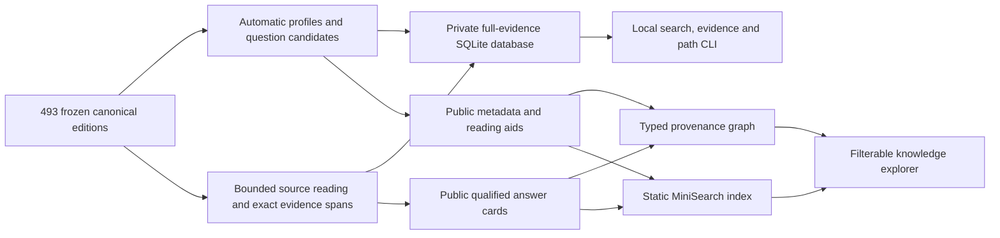

# Transcript Knowledge

[Open the knowledge explorer](https://occult-kranti.github.io/channels-ET/dist/transcript-knowledge/)

This extension turns the retained Channel Lab frame into a source-linked reading
and retrieval workspace. It preserves the distinction between a question in a
published transcript, an uncertain machine-extracted question, a generated
reading prompt and a curated comparison. Automatic processing is not close
reading; source attribution is not verification of a claimed speaker.

## How the pieces fit



The canonical frame contains 493 documents, 1,411,446 whitespace words and 26
publisher contexts. Creator-context IDs, publisher accounts, medium names and
printed attributed labels remain distinct. The new layer reuses the existing
TF-IDF, topic and MiniLM representations; it does not count a new transcript
edition as another independent recording.

## Reading and searching

The browser searches public titles, profiles, candidate cues and released
annotations. It does not search the full private transcripts. Source and context
filters expose what was actually processed or inspected. Exact private passage
locations and hashes make each retained card auditable without publishing whole
source bodies. Unknown speaker identity, missing dates, missing answers and
unreviewed candidates remain explicit states.

The private SQLite database supports full-evidence search and exact passage
retrieval. The downloadable public SQLite database contains the released
annotations and source metadata, with raw text columns empty and no passage
rows. Graph paths distinguish publishing, context attribution, printed labels,
lexical mixture and evidence support. Computed semantic similarity is a separate
optional edge type; it does not establish agreement or entity identity.

## Open-source components and research

MiniSearch is vendored with its MIT license and exact package/commit hashes, so
browser search works without a hosted service. SQLite FTS5 supplies local text
search. The numerical comparison reuses the pinned MiniLM encoder and original
source representations, adding only query encodings. Typed graph provenance and
context preservation are informed by inspected GraphRAG, LightRAG, HippoRAG and
related work; this implementation does not claim to reproduce their training,
extraction models or reported benchmarks.

The [literature review](LITERATURE.md) identifies the actual inspected papers,
repository code, access depth, licenses and methods used. A critical lesson from
both the prior project and the literature is to retain source passages alongside
summaries: summaries can omit conditions, and partially covered card indexes can
distort retrieval rankings.

## Reproduce and inspect

The [protocol](PROTOCOL.md) records the exploratory scope and prospective
implementation choices. [Extraction](EXTRACTION.md), [curated readings](READINGS.md),
[retrieval/database schema](RETRIEVAL-SCHEMA.md), [methods](METHODS.md),
[critical review](REVIEW.md) and [interface checks](DESIGN.md) describe each owner’s
executed work and limitations.

```bash
python3 research/transcript-knowledge/verify_release.py --site .
python3 research/transcript-knowledge/extract.py --help
python3 research/transcript-knowledge/retrieve_graph.py --help
python3 research/transcript-knowledge/query_semantic.py --help
```

`query_semantic.py` supports arbitrary local TF-IDF, MiniLM and hybrid queries
with source/context/date filters, source citations and per-method scores. It
checks the frozen database/model/vector bindings and applies filters before
ranking. It returns candidates rather than generated answers. The numerical
options require the pinned local model and analysis environment; the simpler
SQLite search and evidence commands use Python's standard library. Runnable
commands and artifact locations are in [METHODS.md](METHODS.md).

For offline browsing, copy the static release and serve the repository directory
with `python3 -m http.server 8765`, then open
`http://localhost:8765/dist/transcript-knowledge/`. The interface has no hosted
inference or external search-library dependency; opening its HTML directly with
`file://` does not provide the HTTP fetch behavior its data loader needs.

Full reproduction requires the retained hash-bound private sources and model
artifacts. Public metadata does not reconstruct those missing bodies. Producers
emit explicit public allowlists; `build_public.py` verifies bytes and privacy
boundaries before copying them. `verify_release.py` checks the complete static
file set and delegates extraction, annotation and graph/database invariants to
the producing modules. The earlier Channel Lab and knowledge bank remain
available as separate editions.

## Executed release

| Layer | Executed coverage | Interpretation |
| --- | --- | --- |
| Automatic source profiles | 493 editions; 1,411,446 words; 26 publisher contexts | Full-body processing, not 493 close readings |
| Typed extraction bank | 9,424 entries | 2,523 printed Ra pairs, 6,408 uncertain question cues and 493 generated reading tasks |
| Printed-pair exceptions | Four pairs have missing-question placeholders; 107 unpaired response turns are excluded | The pair count is not a count of fully readable independent questions |
| No observed question cues | 41 sources contain only the generated reading task | Missing questions are not invented |
| Private navigational extracts | 39,579 selected words with exact source locators | Automatic extracts can omit important context; standalone faithfulness is unvalidated |
| Curated readings | 27 cards, 26 questions, 26 context notes | 19 new bounded readings plus eight exact-edition legacy cards |
| Inspected evidence | 22,042 unique words across 42 canonical documents | Combines new and earlier inspected spans, with overlaps removed; no audio listening or human validation |
| Typed graph | 622 nodes, 3,664 edges | Source/context/label/factor and curated-evidence connections; extraction records remain a separate layer |

The initial browser profiles and index contain 6.27 MB of compact JSON; the 493
source shards load on demand. The private database includes all canonical
bodies, 3,076 nonoverlapping 500-word retrieval passages and exact question/card
evidence. The public database has 547 approved search items and zero raw source
text or passage rows. Both are retained as separate, hash-verified artifacts.

On the twelve independently frozen, source-informed information needs, BM25's
mean reciprocal rank was **0.9167**, versus **0.9333** for rank fusion. That small
aggregate does not establish superiority: BM25 returned all twelve known
supports by rank three; fusion returned eleven by rank three and twelve by rank
five. Publisher-family macro averaging slightly favors BM25 instead. For one
Council-identity question, BM25 placed the known source first, MiniLM 284th and
fusion fifth. Keep lexical retrieval available and inspect the evidence rather
than treating semantic similarity as answer correctness. Four additional control
queries have no invented answer or negative-relevance ground truth.

The review corrected a real wrapped-question truncation defect before full
extraction, strengthened resume checks to include the private bank, prevented
analyst questions from becoming source-asked graph edges, and checked public
database contents against their exact approved text composition. The scientific
audits inspect source bytes, question boundaries, curation qualifiers, retrieval
arithmetic, graph paths and privacy separately. [REVIEW.md](REVIEW.md) records the
actual scope and remaining limitations; browser and deployment receipts identify
the final interface release.

The local release passed 71 focused checks across extraction, curation, search,
graph/database logic, library behavior and publication boundaries. Its complete
browser pass covered 28 groups plus three explicitly separate transport/integrity
fault simulations, including 320-, 390- and 1440-pixel layouts. These software
checks do not measure human annotation reliability or answer accuracy.

The retained full-evidence database in this managed workspace is
`/workspace/channels-et-private/transcript-knowledge-2026-11/accepted/database-01/database-private.sqlite`.
It is not uploaded to GitHub or Google Drive, and the workspace is not permanent
ChatGPT account storage. The public download is
[`database-public.sqlite`](../../dist/transcript-knowledge/database-public.sqlite).
