# Independent transcript-study UI audit

**PASS — 395 main rendered/source checks, five additional mobile-dialog checks, and nine successfully rendered research figures.** The final run used the held local build on port 8016. All 70 downloadable artifacts matched their declared SHA-256/size and the retained repository sources. The browser's actually loaded HTML, CSS, JavaScript and data were pinned separately and remained unchanged throughout the run. See [review.json](review.json), [browser-review.json](browser-review.json), [mobile-dialog-review.json](mobile-dialog-review.json), and [methods-visual-review.json](methods-visual-review.json).

The audit used the Product Design audit workflow: capture the actual flow, inspect the saved screenshots, test interactions, then tie findings to those captures. It used the installed Playwright and Chromium in fresh contexts with a loopback-only request allowlist. No external request, source acquisition, authentication or media download occurred. The saved Product Design context preflight returned no saved context; the user's explicit Chromium/Playwright preference supplied the browser choice.

1. **Overview and source selection — Pass.** The first view distinguishes 20 ASR documents from 16 separately fitted publisher texts and zero saved YouTube videos. Source context counts are 19 Bashar-related recordings and one Ashtar-attributed episode; the interface does not call them 20 mediums. Keyboard source inspection exposes exact hashes, source format and unverified speaker/video status. Escape closes the native dialog and returns focus.

   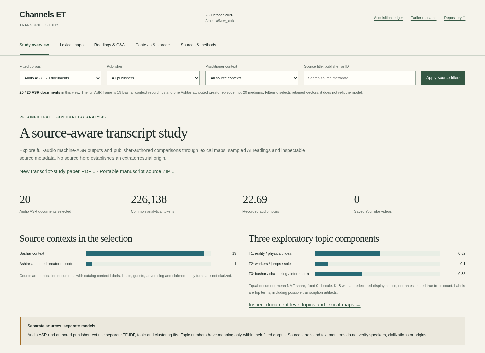
   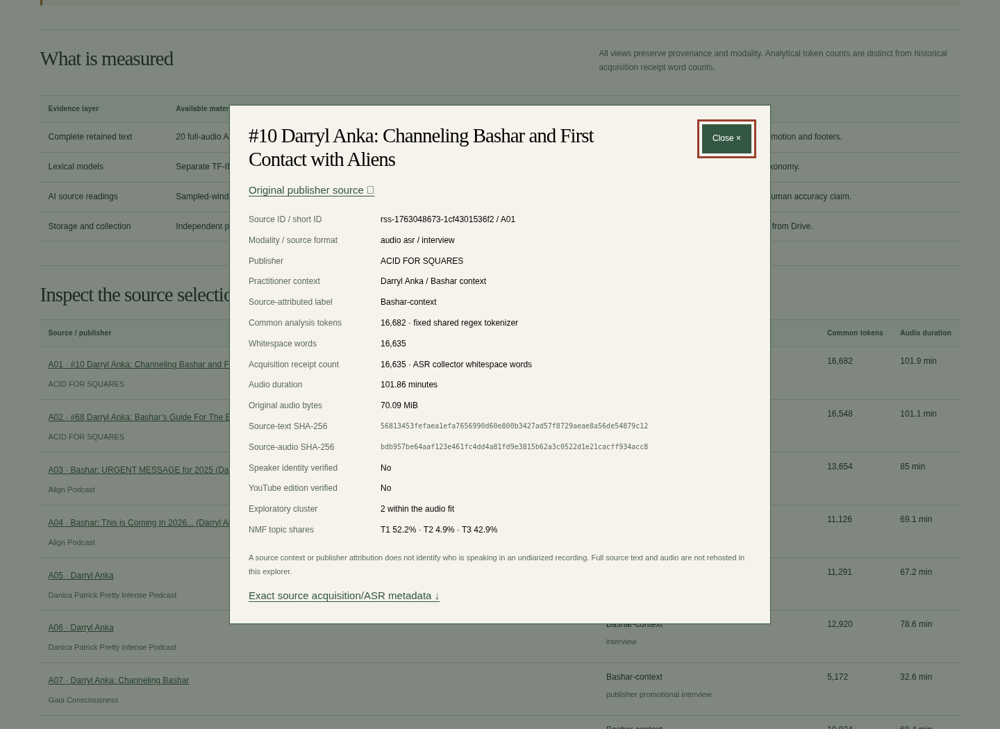

2. **Lexical maps, topics and terms — Pass after one correction.** The default network's top-two-neighbor union at cosine ≥0.20 matches an independent calculation from the source matrix, including its actual export. A threshold of 1.00 removes edges while retaining all source nodes. Missing search results retain a recovery explanation. Source/topic filters select existing vectors without refitting. ASR clusters remain a 19-versus-one source partition, not a discovery of ET groups. The 16 authored reference projections are marked separately, exported with the display rule, and can now open their own provenance inspector. Separate authored topics, publisher means, TF-IDF term exports, dictionary mentions and unavailable authored time profiles were exercised.

   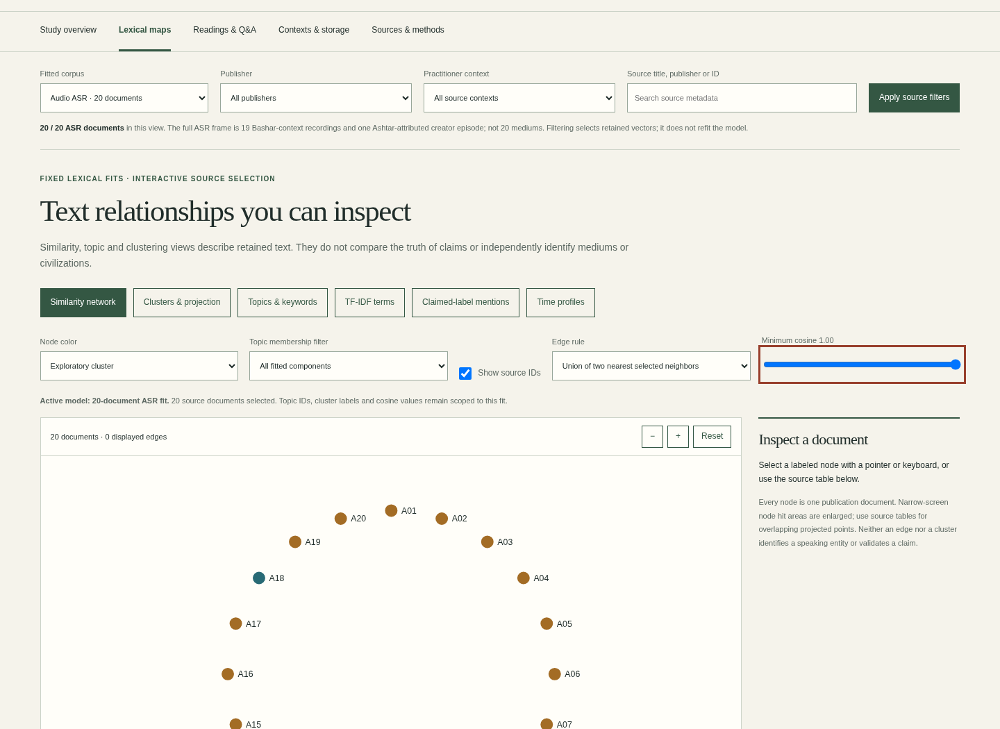
   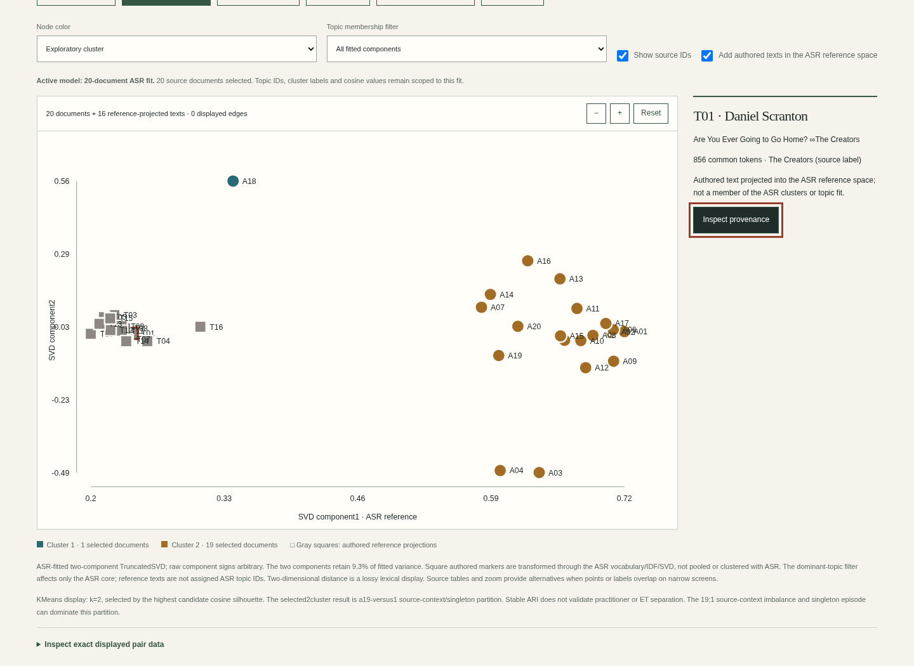
   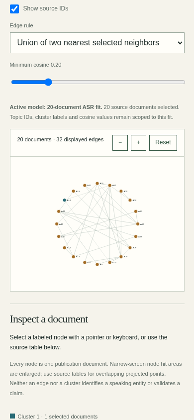

3. **Sampled reading and candidate questions — Pass.** The UI retains 37 typed, paraphrased candidates: 21 audio question-like records and 16 analyst-constructed authored comparison prompts. Candidate kind, prompt family, search, pagination, provenance and filtered export were checked. An unchanged filter preserves its results; a missing query is not presented as evidence that a source has no questions. Reading coverage remains 11,992/226,093 ASR words and 6,319/13,656 authored words over 105 inspected windows; these are sampled-reading exposure figures, not full-corpus prevalence or human validation.

   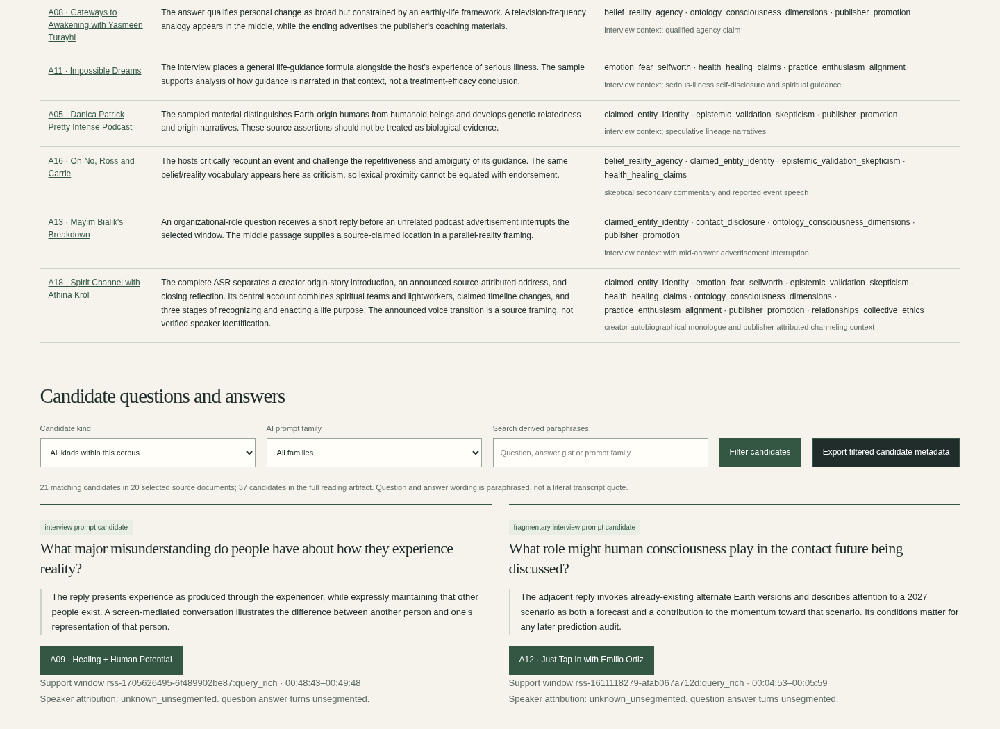

4. **Contexts and actual storage — Pass.** All five inventory association frames retain assigned, unassigned and overlapping membership counts. For example, practitioner associations cover 454/942 IDs with 488 unassigned; publisher groups cover 886/942 with 56 unassigned. Actual YouTube video/audio/caption artifacts remain zero. Canonical publisher accounting sums 99 artifacts and 1,703,635,307 bytes, separately from the completed 200-file managed-local archive. Drive uploads remain zero and environment retention is not guaranteed. Raw local paths are not false browser download links.

   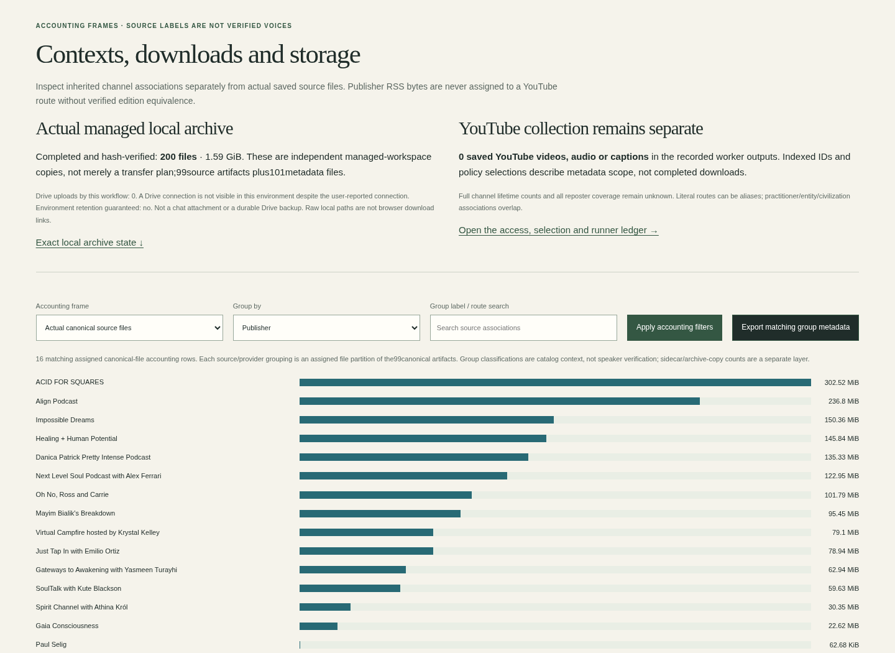
   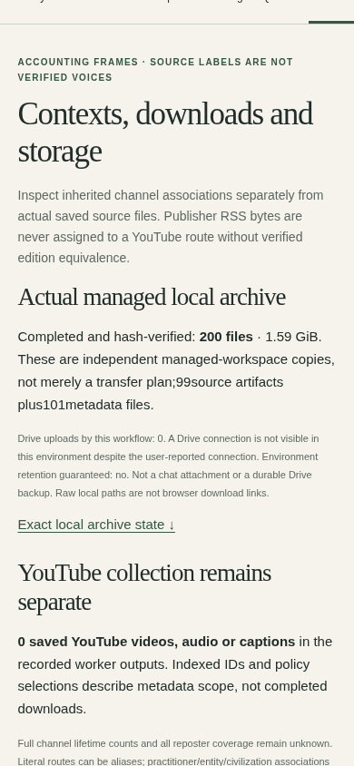

5. **Methods, figures and downloads — Pass.** All 70 downloadable numerical, provenance, figure and manuscript artifacts match retained bytes. The nine figure images render successfully. Commercial-vocabulary sensitivity retains two cohort-specific records: ASR rank correlation 0.9980229806628265 and 90% nearest-neighbor preservation; authored text 1.0 and 100%. The authored result is not assigned to ASR. Full-fit figures are labeled as unaffected by source filters.

   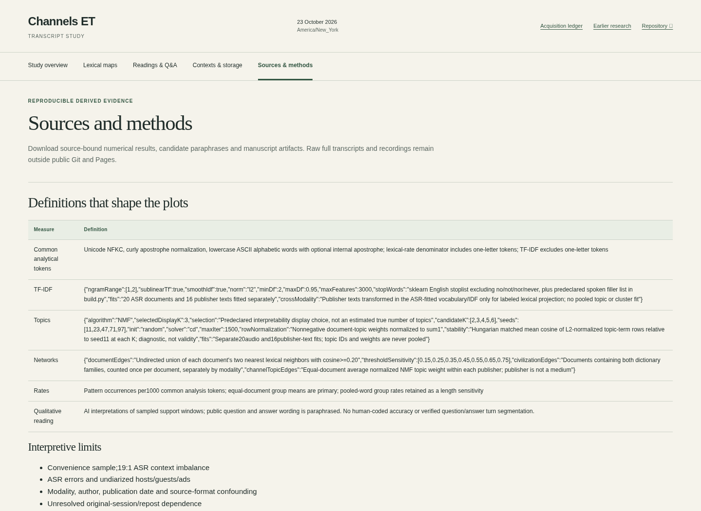
   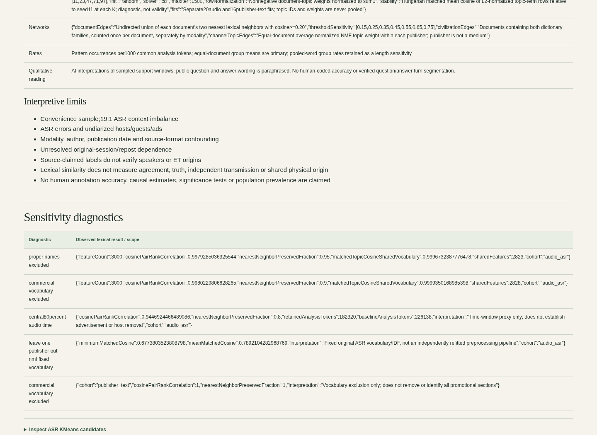

6. **Mobile, keyboard, reflow and entry routes — Pass within the tested scope.** All five views fit a 390-pixel viewport without page-level horizontal overflow. The 200%-equivalent desktop reflow check uses a 720-CSS-pixel viewport at device-pixel ratio two, rather than claiming an OS/browser-menu zoom operation. Native source dialogs, skip links, graph selection and threshold controls work by keyboard. Mobile graph hit-area bounds measured 24.8177 CSS pixels; dense labels and overlapping projection points still benefit from the source/pair tables and zoom controls. The old Acquisition navigation opens the new study at 390 pixels. The latest root entry opens this study by default and preserves query/hash routing to the prior research and legacy atlas.

   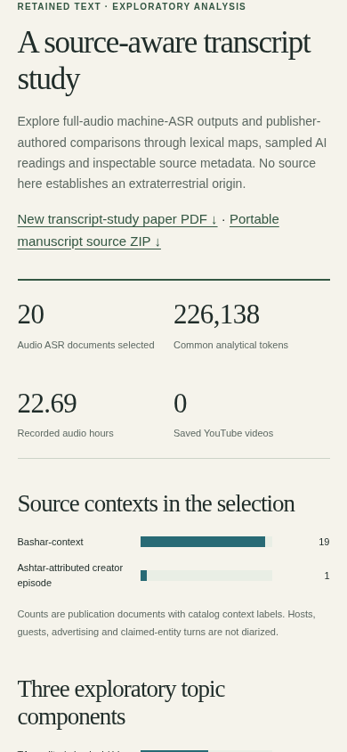
   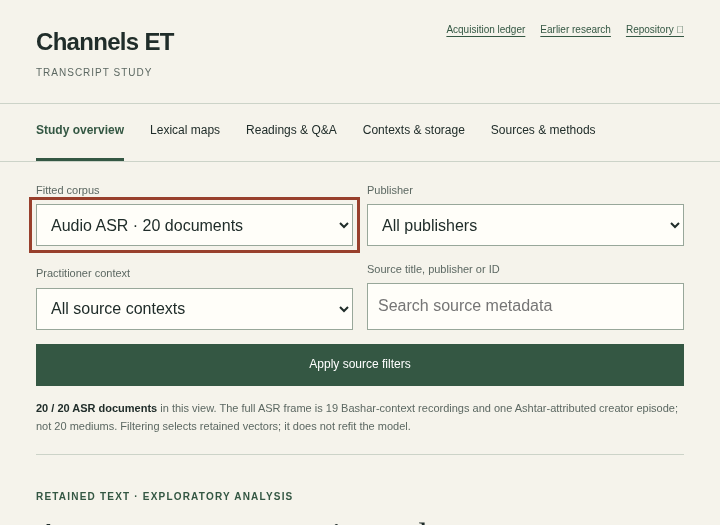
   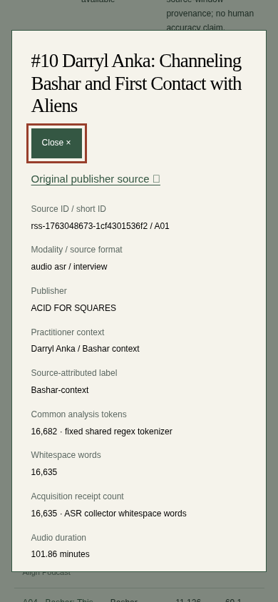
   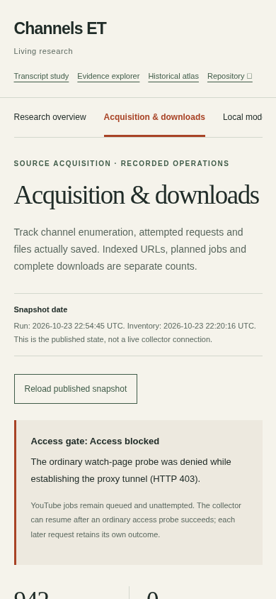

The material UI correction found in the rendered audit was an authored reference point that could be selected but could not populate the inspector. The owner corrected the visible-document lookup and labeled reference-projected texts as outside the ASR cluster/topic fit. The final rendered regression and export checks pass. The initial failure capture is retained as [03-overlay-selected.png](03-overlay-selected.png); it is pre-fix evidence, not the final accepted screen.

Remaining nonblocking limits are small mobile graph labels/overlapping projected points and some dense method/count copy. The interface supplies larger hit areas, zoom, exact tables and provenance dialogs. This audit is not a complete WCAG certification, screen-reader/device matrix, contrast measurement, semantic validation of ASR or human annotation, or a new live Pages audit. The root coordinator performs deployment and live byte verification separately. No owner source, scientific artifact, prior proof, or raw source file was modified by the reviewer.

Reproduce the final local checks against the same held server with:

```bash
TRANSCRIPT_REVIEW_URL=http://127.0.0.1:8016/channels-ET/dist/transcripts/ FINAL_REVIEW=1 node research/transcript-ui-review/check-ui.cjs
TRANSCRIPT_REVIEW_URL=http://127.0.0.1:8016/channels-ET/dist/transcripts/ node research/transcript-ui-review/check-mobile-dialog.cjs
TRANSCRIPT_REVIEW_URL=http://127.0.0.1:8016/channels-ET/dist/transcripts/ node research/transcript-ui-review/capture-methods.cjs
```

These commands refresh this audit's own working receipts/screenshots. Final scientific and UI input hashes must remain held; a source or asset change requires a new dated review rather than reusing this acceptance.
